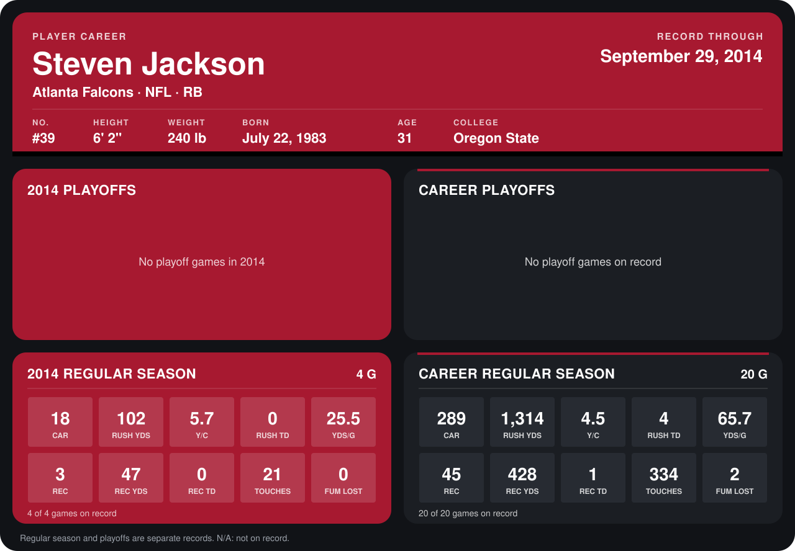

# Steven Jackson

## Career stats

### Regular season

| Season | Team | Age | # | G | CAR | RUSH YDS | Y/C | RUSH TD | YDS/G | REC | REC YDS | REC TD | TOUCHES | FUM LOST |
|---|---|---:|---:|---:|---:|---:|---:|---:|---:|---:|---:|---:|---:|---:|
| 2013 | Atlanta Falcons | 30 | 39 | 16 | 271 | 1,212 | 4.5 | 4 | 75.8 | 42 | 381 | 1 | 313 | 2 |
| 2014 | Atlanta Falcons | 31 | 39 | 4 | 18 | 102 | 5.7 | 0 | 25.5 | 3 | 47 | 0 | 21 | 0 |
| **Career** |  |  |  | 20 | 289 | 1,314 | 4.5 | 4 | 65.7 | 45 | 428 | 1 | 334 | 2 |

### Playoffs

No playoff games on record.

## Awards

None on record.

Age is his age on the league's opening game of each season; # is the number listed for him that season with that team (2014: the card's rule; 2013: the 2013 season roster), N/A where no listing applies.

Records through September 28, 2014. Identity: listed 2014 roster data, Weeks 1-4; number: 2014 Week 1 roster. [All Atlanta Falcons players](README.md).
