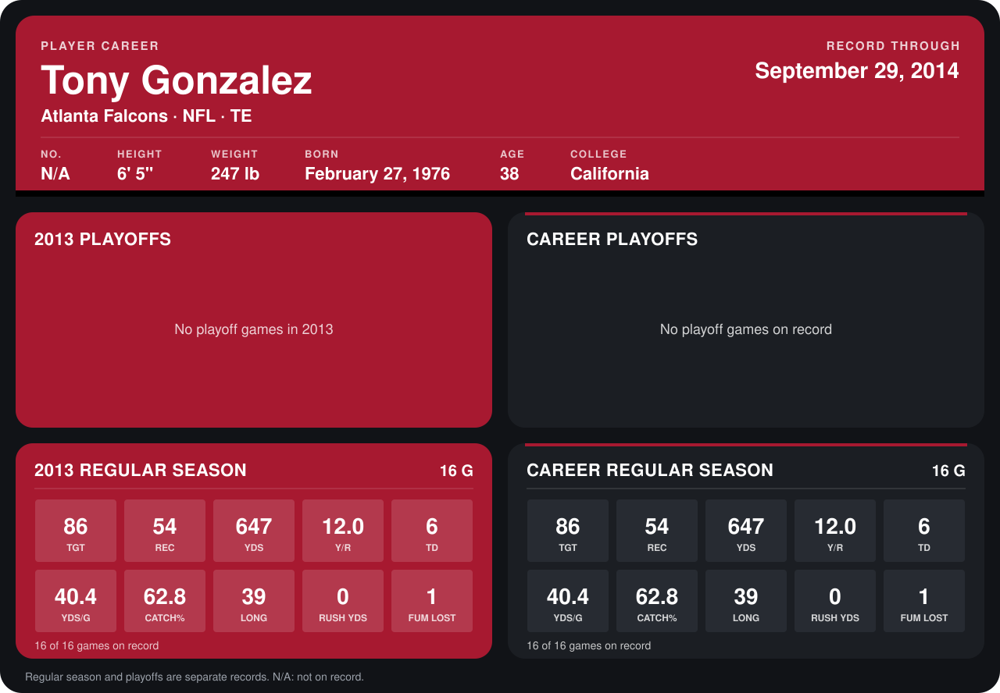

# Tony Gonzalez

## Career stats

### Regular season

| Season | Club | G | TGT | REC | YDS | Y/R | TD | YDS/G | CATCH% | LONG | RUSH YDS | FUM LOST |
|---|---|---:|---:|---:|---:|---:|---:|---:|---:|---:|---:|---:|
| 2013 | Atlanta Falcons | 16 | 86 | 54 | 647 | 12.0 | 6 | 40.4 | 62.8 | 39 | 0 | 1 |
| **Career** |  | 16 | 86 | 54 | 647 | 12.0 | 6 | 40.4 | 62.8 | 39 | 0 | 1 |

### Playoffs

No playoff games on record.

## Awards

- Pro Bowl selection (2013, TE)

Records through September 29, 2014. Identity: the public player file's latest listing (no 2014 Weeks 1-4 roster row). [All Atlanta Falcons players](README.md).
