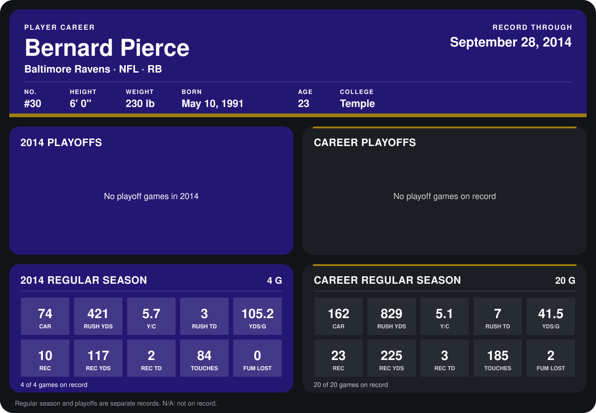

# Bernard Pierce

## Career stats

### Regular season

| Season | Club | G | CAR | RUSH YDS | Y/C | RUSH TD | YDS/G | REC | REC YDS | REC TD | TOUCHES | FUM LOST |
|---|---|---:|---:|---:|---:|---:|---:|---:|---:|---:|---:|---:|
| 2013 | Baltimore Ravens | 16 | 88 | 408 | 4.6 | 4 | 25.5 | 13 | 108 | 1 | 101 | 2 |
| 2014 | Baltimore Ravens | 4 | 74 | 421 | 5.7 | 3 | 105.2 | 10 | 117 | 2 | 84 | 0 |
| **Career** |  | 20 | 162 | 829 | 5.1 | 7 | 41.5 | 23 | 225 | 3 | 185 | 2 |

### Playoffs

No playoff games on record.

## Awards

None on record.

Records through September 29, 2014. Identity: listed 2014 roster data, Weeks 1-4; number: 2014 Week 1 roster. [All Baltimore Ravens players](README.md).
