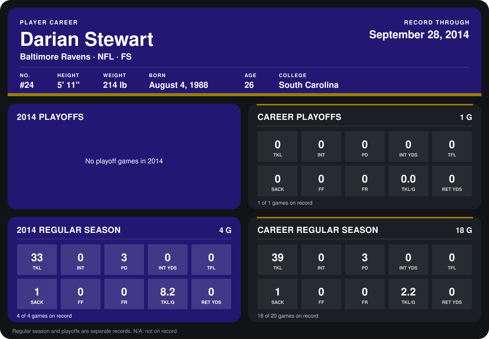

# Darian Stewart

## Career stats

### Regular season

| Season | Club | G | TKL | INT | PD | INT YDS | TFL | SACK | FF | FR | TKL/G | RET YDS |
|---|---|---:|---:|---:|---:|---:|---:|---:|---:|---:|---:|---:|
| 2013 | St. Louis Rams | 14 | 6 | 0 | 0 | 0 | 0 | 0 | 0 | 0 | 0.4 | 0 |
| 2014 | Baltimore Ravens | 4 | 33 | 0 | 3 | 0 | 0 | 1 | 0 | 0 | 8.2 | 0 |
| **Career** |  | 18 | 39 | 0 | 3 | 0 | 0 | 1 | 0 | 0 | 2.2 | 0 |

### Playoffs

| Season | Club | G | TKL | INT | PD | INT YDS | TFL | SACK | FF | FR | TKL/G | RET YDS |
|---|---|---:|---:|---:|---:|---:|---:|---:|---:|---:|---:|---:|
| 2013 | St. Louis Rams | 1 | 0 | 0 | 0 | 0 | 0 | 0 | 0 | 0 | 0.0 | 0 |
| **Career** |  | 1 | 0 | 0 | 0 | 0 | 0 | 0 | 0 | 0 | 0.0 | 0 |

## Awards

None on record.

Records through September 29, 2014. Identity: listed 2014 roster data, Weeks 1-4; number: 2014 Week 1 roster. [All Baltimore Ravens players](README.md).
