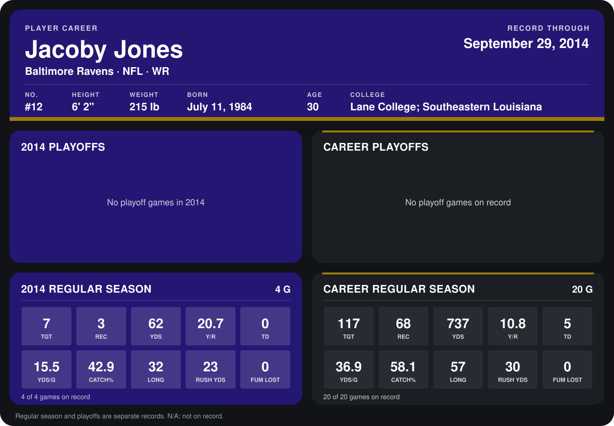

# Jacoby Jones

## Career stats

### Regular season

| Season | Team | Age | # | G | TGT | REC | YDS | Y/R | TD | YDS/G | CATCH% | LONG | RUSH YDS | FUM LOST |
|---|---|---:|---:|---:|---:|---:|---:|---:|---:|---:|---:|---:|---:|---:|
| 2013 | Baltimore Ravens | 29 | 12 | 16 | 110 | 65 | 675 | 10.4 | 5 | 42.2 | 59.1 | 57 | 7 | 0 |
| 2014 | Baltimore Ravens | 30 | 12 | 4 | 7 | 3 | 62 | 20.7 | 0 | 15.5 | 42.9 | 32 | 23 | 0 |
| **Career** |  |  |  | 20 | 117 | 68 | 737 | 10.8 | 5 | 36.9 | 58.1 | 57 | 30 | 0 |

### Playoffs

No playoff games on record.

## Awards

- AFC Special Teams Player of the Week (2013, Week 6)
- AP Second-Team All-Pro (2013, KR)
- Pro Bowl selection (2013, RS)

Age is his age on the league's opening game of each season; # is the number listed for him that season with that team (2014: the card's rule; 2013: the 2013 season roster), N/A where no listing applies.

Records through September 28, 2014. Identity: listed 2014 roster data, Weeks 1-4; number: 2014 Week 1 roster. [All Baltimore Ravens players](README.md).
