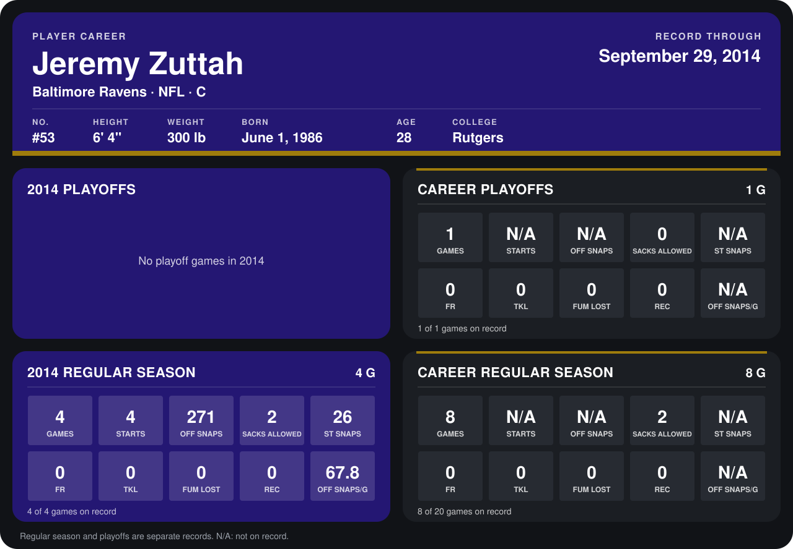

# Jeremy Zuttah

## Career stats

### Regular season

| Season | Club | G | STARTS | OFF SNAPS | SACKS ALLOWED | ST SNAPS | FR | TKL | FUM LOST | REC | OFF SNAPS/G |
|---|---|---:|---:|---:|---:|---:|---:|---:|---:|---:|---:|
| 2013 | Tampa Bay Buccaneers | 4 | N/A | N/A | 0 | N/A | 0 | 0 | 0 | 0 | N/A |
| 2014 | Baltimore Ravens | 5 | 5 | 331 | 2 | 32 | 0 | 0 | 0 | 0 | 66.2 |
| **Career** |  | 9 | N/A | N/A | 2 | N/A | 0 | 0 | 0 | 0 | N/A |

### Playoffs

| Season | Club | G | STARTS | OFF SNAPS | SACKS ALLOWED | ST SNAPS | FR | TKL | FUM LOST | REC | OFF SNAPS/G |
|---|---|---:|---:|---:|---:|---:|---:|---:|---:|---:|---:|
| 2013 | Tampa Bay Buccaneers | 1 | N/A | N/A | 0 | N/A | 0 | 0 | 0 | 0 | N/A |
| **Career** |  | 1 | N/A | N/A | 0 | N/A | 0 | 0 | 0 | 0 | N/A |

## Awards

None on record.

Records through October 5, 2014. Identity: listed 2014 roster data, Weeks 1-4; number: 2014 Week 1 roster. [All Baltimore Ravens players](README.md).
