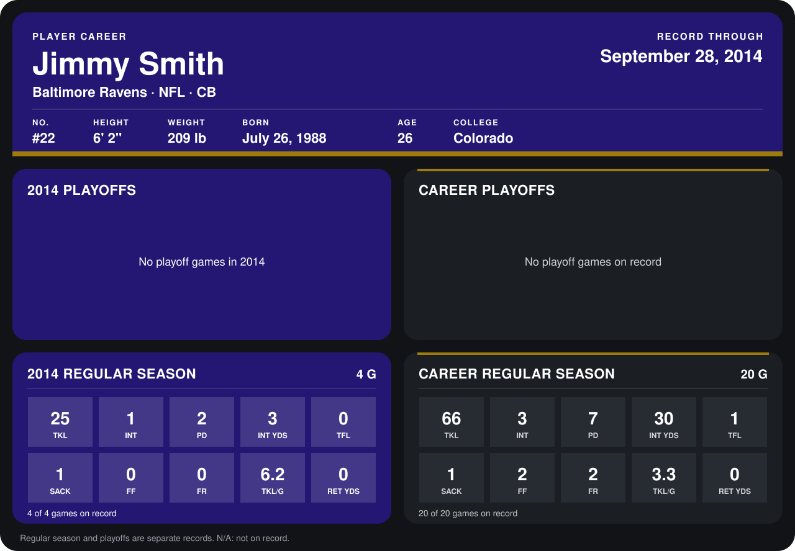

# Jimmy Smith

## Career stats

### Regular season

| Season | Team | Age | # | G | TKL | INT | PD | INT YDS | TFL | SACK | FF | FR | TKL/G | RET YDS |
|---|---|---:|---:|---:|---:|---:|---:|---:|---:|---:|---:|---:|---:|---:|
| 2013 | Baltimore Ravens | 25 | 22 | 16 | 41 | 2 | 5 | 27 | 1 | 0 | 2 | 2 | 2.6 | 0 |
| 2014 | Baltimore Ravens | 26 | 22 | 5 | 33 | 2 | 4 | 62 | 0 | 1 | 0 | 0 | 6.6 | 0 |
| **Career** |  |  |  | 21 | 74 | 4 | 9 | 89 | 1 | 1 | 2 | 2 | 3.5 | 0 |

### Playoffs

No playoff games on record.

## Awards

None on record.

Age is his age on the league's opening game of each season; # is the number listed for him that season with that team (2014: the card's rule; 2013: the 2013 season roster), N/A where no listing applies.

Records through October 5, 2014. Identity: listed 2014 roster data, Weeks 1-4; number: 2014 Week 1 roster. [All Baltimore Ravens players](README.md).
