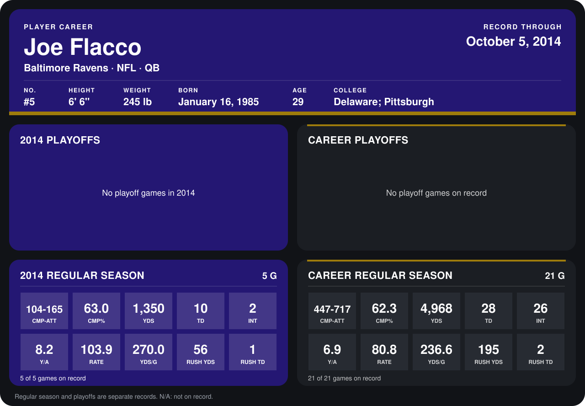

# Joe Flacco

## Career stats

### Regular season

| Season | Team | Age | # | G | CMP-ATT | CMP% | YDS | TD | INT | Y/A | RATE | YDS/G | RUSH YDS | RUSH TD |
|---|---|---:|---:|---:|---:|---:|---:|---:|---:|---:|---:|---:|---:|---:|
| 2013 | Baltimore Ravens | 28 | 5 | 16 | 343-552 | 62.1 | 3,618 | 18 | 24 | 6.6 | 73.9 | 226.1 | 139 | 1 |
| 2014 | Baltimore Ravens | 29 | 5 | 4 | 83-135 | 61.5 | 1,108 | 9 | 1 | 8.2 | 106.7 | 277.0 | 51 | 1 |
| **Career** |  |  |  | 20 | 426-687 | 62.0 | 4,726 | 27 | 25 | 6.9 | 80.4 | 236.3 | 190 | 2 |

### Playoffs

No playoff games on record.

## Awards

None on record.

Age is his age on the league's opening game of each season; # is the number listed for him that season with that team (2014: the card's rule; 2013: the 2013 season roster), N/A where no listing applies.

Records through September 28, 2014. Identity: listed 2014 roster data, Weeks 1-4; number: 2014 Week 1 roster. [All Baltimore Ravens players](README.md).
