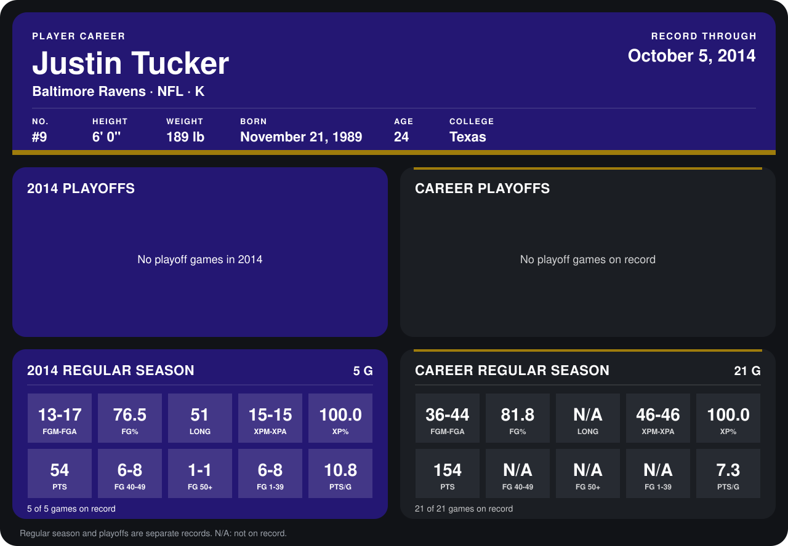

# Justin Tucker

## Career stats

### Regular season

| Season | Club | G | FGM-FGA | FG% | LONG | XPM-XPA | XP% | PTS | FG 40-49 | FG 50+ | FG 1-39 | PTS/G |
|---|---|---:|---:|---:|---:|---:|---:|---:|---:|---:|---:|---:|
| 2013 | Baltimore Ravens | 16 | 23-27 | 85.2 | N/A | 31-31 | 100.0 | 100 | N/A | N/A | N/A | 6.2 |
| 2014 | Baltimore Ravens | 4 | 9-12 | 75.0 | 46 | 14-14 | 100.0 | 41 | 5-6 | 0-0 | 4-6 | 10.2 |
| **Career** |  | 20 | 32-39 | 82.1 | N/A | 45-45 | 100.0 | 141 | N/A | N/A | N/A | 7.0 |

### Playoffs

No playoff games on record.

## Awards

- AFC Special Teams Player of the Week (2014, Week 4)

Records through September 28, 2014. Identity: listed 2014 roster data, Weeks 1-4; number: 2014 Week 1 roster. [All Baltimore Ravens players](README.md).
