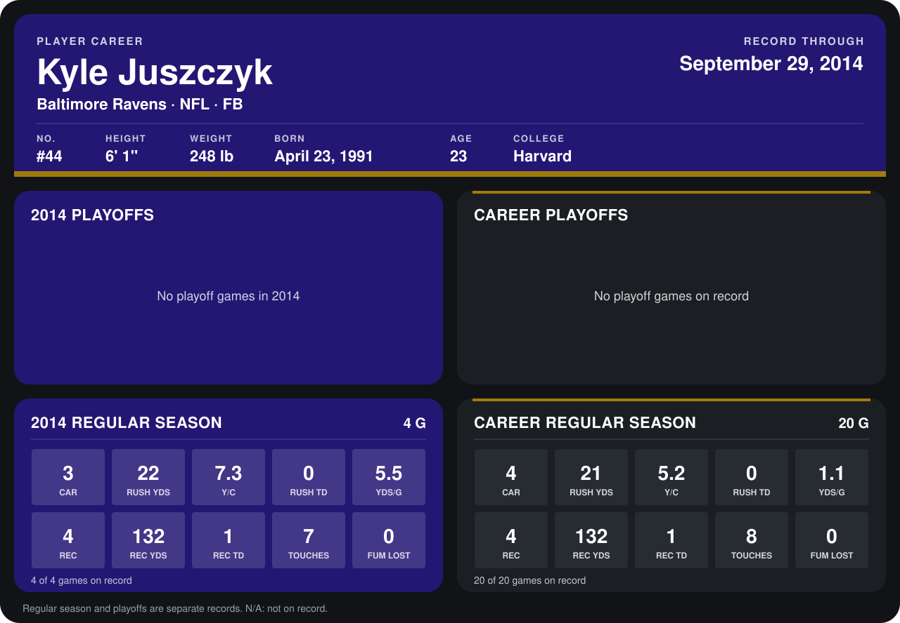

# Kyle Juszczyk

## Career stats

### Regular season

| Season | Team | Age | # | G | CAR | RUSH YDS | Y/C | RUSH TD | YDS/G | REC | REC YDS | REC TD | TOUCHES | FUM LOST |
|---|---|---:|---:|---:|---:|---:|---:|---:|---:|---:|---:|---:|---:|---:|
| 2013 | Baltimore Ravens | 22 | 40 | 16 | 1 | -1 | -1.0 | 0 | -0.1 | 0 | 0 | 0 | 1 | 0 |
| 2014 | Baltimore Ravens | 23 | 44 | 5 | 3 | 22 | 7.3 | 0 | 4.4 | 4 | 132 | 1 | 7 | 0 |
| **Career** |  |  |  | 21 | 4 | 21 | 5.2 | 0 | 1.0 | 4 | 132 | 1 | 8 | 0 |

### Playoffs

No playoff games on record.

## Awards

None on record.

Age is his age on the league's opening game of each season; # is the number listed for him that season with that team (2014: the card's rule; 2013: the 2013 season roster), N/A where no listing applies.

Records through October 5, 2014. Identity: listed 2014 roster data, Weeks 1-4; number: 2014 Week 1 roster. [All Baltimore Ravens players](README.md).
