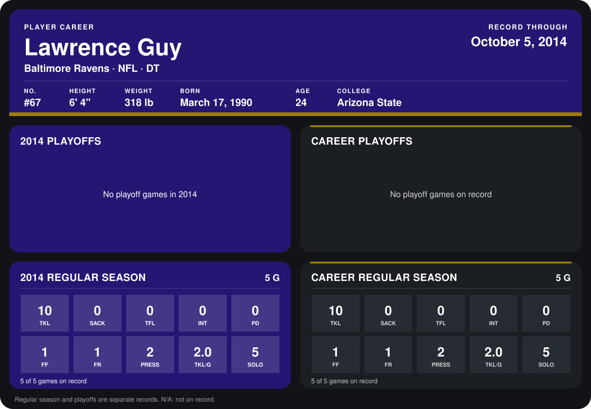

# Lawrence Guy

## Career stats

### Regular season

| Season | Club | G | TKL | SACK | TFL | INT | PD | FF | FR | PRESS | TKL/G | SOLO |
|---|---|---:|---:|---:|---:|---:|---:|---:|---:|---:|---:|---:|
| 2014 | San Diego Chargers, Baltimore Ravens | 5 | 10 | 0 | 0 | 0 | 0 | 1 | 1 | 2 | 2.0 | 5 |
| **Career** |  | 5 | 10 | 0 | 0 | 0 | 0 | 1 | 1 | 2 | 2.0 | 5 |

### Playoffs

No playoff games on record.

## Awards

None on record.

Records through October 5, 2014. Identity: listed 2014 roster data, Weeks 1-4; number: 2014 Week 4 roster listing. [All Baltimore Ravens players](README.md).
