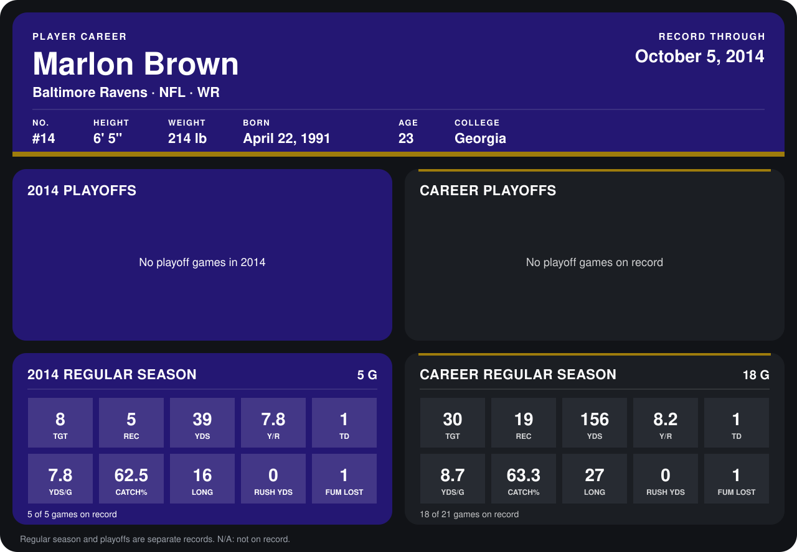

# Marlon Brown

## Career stats

### Regular season

| Season | Club | G | TGT | REC | YDS | Y/R | TD | YDS/G | CATCH% | LONG | RUSH YDS | FUM LOST |
|---|---|---:|---:|---:|---:|---:|---:|---:|---:|---:|---:|---:|
| 2013 | Baltimore Ravens | 13 | 22 | 14 | 117 | 8.4 | 0 | 9.0 | 63.6 | 27 | 0 | 0 |
| 2014 | Baltimore Ravens | 4 | 8 | 5 | 39 | 7.8 | 1 | 9.8 | 62.5 | 16 | 0 | 1 |
| **Career** |  | 17 | 30 | 19 | 156 | 8.2 | 1 | 9.2 | 63.3 | 27 | 0 | 1 |

### Playoffs

No playoff games on record.

## Awards

None on record.

Records through September 28, 2014. Identity: listed 2014 roster data, Weeks 1-4; number: 2014 Week 1 roster. [All Baltimore Ravens players](README.md).
