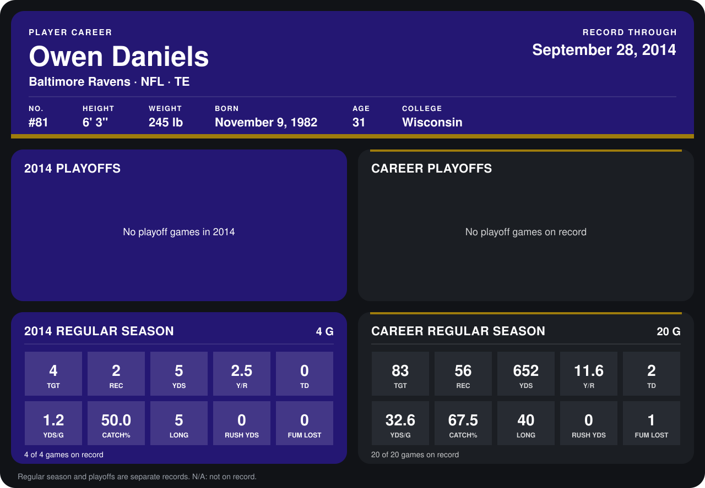

# Owen Daniels

## Career stats

### Regular season

| Season | Club | G | TGT | REC | YDS | Y/R | TD | YDS/G | CATCH% | LONG | RUSH YDS | FUM LOST |
|---|---|---:|---:|---:|---:|---:|---:|---:|---:|---:|---:|---:|
| 2013 | Houston Texans | 16 | 79 | 54 | 647 | 12.0 | 2 | 40.4 | 68.4 | 40 | 0 | 1 |
| 2014 | Baltimore Ravens | 4 | 4 | 2 | 5 | 2.5 | 0 | 1.2 | 50.0 | 5 | 0 | 0 |
| **Career** |  | 20 | 83 | 56 | 652 | 11.6 | 2 | 32.6 | 67.5 | 40 | 0 | 1 |

### Playoffs

No playoff games on record.

## Awards

None on record.

Records through September 29, 2014. Identity: listed 2014 roster data, Weeks 1-4; number: 2014 Week 1 roster. [All Baltimore Ravens players](README.md).
