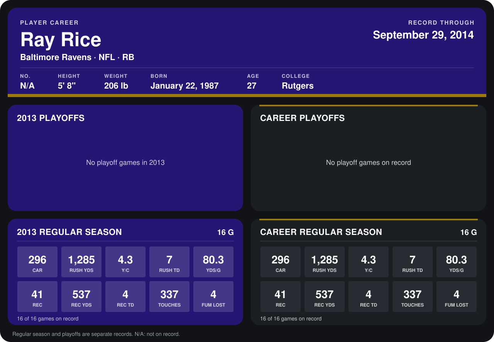

# Ray Rice

## Career stats

### Regular season

| Season | Club | G | CAR | RUSH YDS | Y/C | RUSH TD | YDS/G | REC | REC YDS | REC TD | TOUCHES | FUM LOST |
|---|---|---:|---:|---:|---:|---:|---:|---:|---:|---:|---:|---:|
| 2013 | Baltimore Ravens | 16 | 296 | 1,285 | 4.3 | 7 | 80.3 | 41 | 537 | 4 | 337 | 4 |
| **Career** |  | 16 | 296 | 1,285 | 4.3 | 7 | 80.3 | 41 | 537 | 4 | 337 | 4 |

### Playoffs

No playoff games on record.

## Awards

- AFC Offensive Player of the Week (2013, Week 1)

Records through December 29, 2013. Identity: his listed 2013 season roster data (no 2014 Weeks 1-4 roster row). [All Baltimore Ravens players](README.md).
