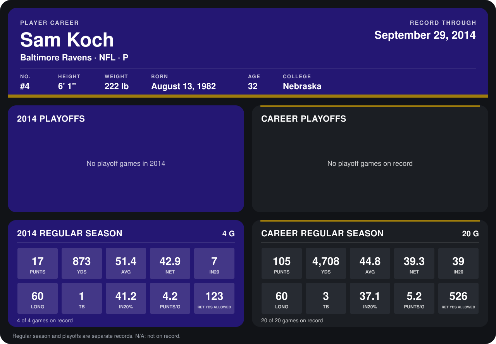

# Sam Koch

## Career stats

### Regular season

| Season | Club | G | PUNTS | YDS | AVG | NET | IN20 | LONG | TB | IN20% | PUNTS/G | RET YDS ALLOWED |
|---|---|---:|---:|---:|---:|---:|---:|---:|---:|---:|---:|---:|
| 2013 | Baltimore Ravens | 16 | 88 | 3,835 | 43.6 | 38.5 | 32 | 59 | 2 | 36.4 | 5.5 | 403 |
| 2014 | Baltimore Ravens | 4 | 17 | 873 | 51.4 | 42.9 | 7 | 60 | 1 | 41.2 | 4.2 | 123 |
| **Career** |  | 20 | 105 | 4,708 | 44.8 | 39.3 | 39 | 60 | 3 | 37.1 | 5.2 | 526 |

### Playoffs

No playoff games on record.

## Awards

None on record.

Records through September 29, 2014. Identity: listed 2014 roster data, Weeks 1-4; number: 2014 Week 1 roster. [All Baltimore Ravens players](README.md).
