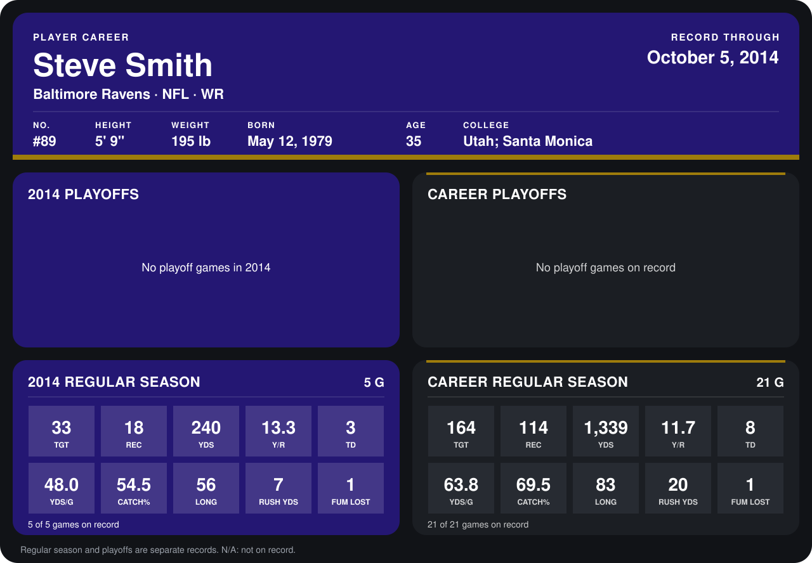

# Steve Smith

## Career stats

### Regular season

| Season | Club | G | TGT | REC | YDS | Y/R | TD | YDS/G | CATCH% | LONG | RUSH YDS | FUM LOST |
|---|---|---:|---:|---:|---:|---:|---:|---:|---:|---:|---:|---:|
| 2013 | Carolina Panthers | 16 | 131 | 96 | 1,099 | 11.4 | 5 | 68.7 | 73.3 | 83 | 13 | 0 |
| 2014 | Baltimore Ravens | 4 | 29 | 16 | 228 | 14.2 | 2 | 57.0 | 55.2 | 56 | 7 | 1 |
| **Career** |  | 20 | 160 | 112 | 1,327 | 11.8 | 7 | 66.3 | 70.0 | 83 | 20 | 1 |

### Playoffs

No playoff games on record.

## Awards

None on record.

Records through September 28, 2014. Identity: listed 2014 roster data, Weeks 1-4; number: 2014 Week 1 roster. [All Baltimore Ravens players](README.md).
