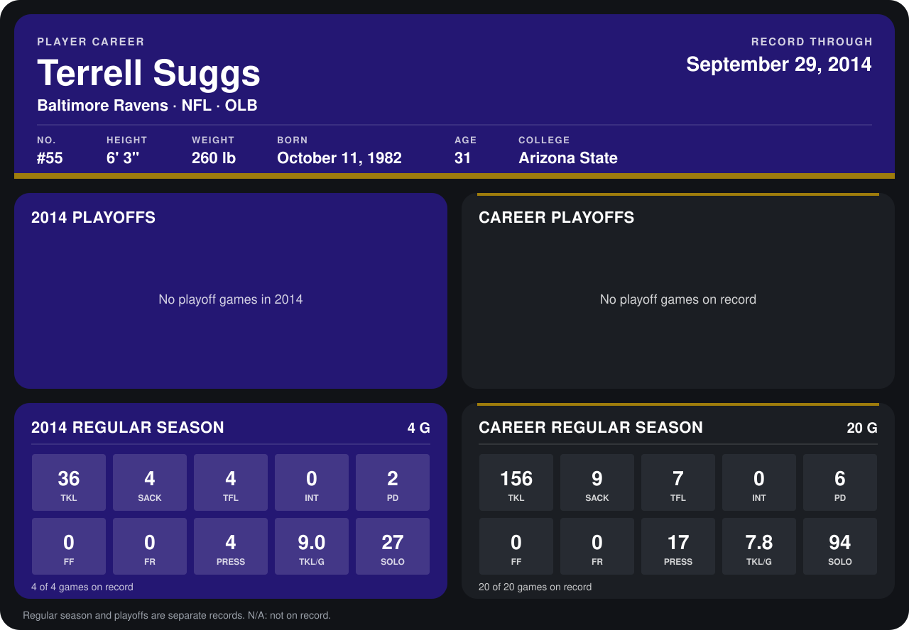

# Terrell Suggs

## Career stats

### Regular season

| Season | Team | Age | # | G | TKL | SACK | TFL | INT | PD | FF | FR | PRESS | TKL/G | SOLO |
|---|---|---:|---:|---:|---:|---:|---:|---:|---:|---:|---:|---:|---:|---:|
| 2013 | Baltimore Ravens | 30 | 55 | 16 | 120 | 5 | 3 | 0 | 4 | 0 | 0 | 13 | 7.5 | 67 |
| 2014 | Baltimore Ravens | 31 | 55 | 5 | 46 | 6 | 4 | 0 | 3 | 0 | 0 | 6 | 9.2 | 37 |
| **Career** |  |  |  | 21 | 166 | 11 | 7 | 0 | 7 | 0 | 0 | 19 | 7.9 | 104 |

### Playoffs

No playoff games on record.

## Awards

None on record.

Age is his age on the league's opening game of each season; # is the number listed for him that season with that team (2014: the card's rule; 2013: the 2013 season roster), N/A where no listing applies.

Records through October 5, 2014. Identity: listed 2014 roster data, Weeks 1-4; number: 2014 Week 1 roster. [All Baltimore Ravens players](README.md).
