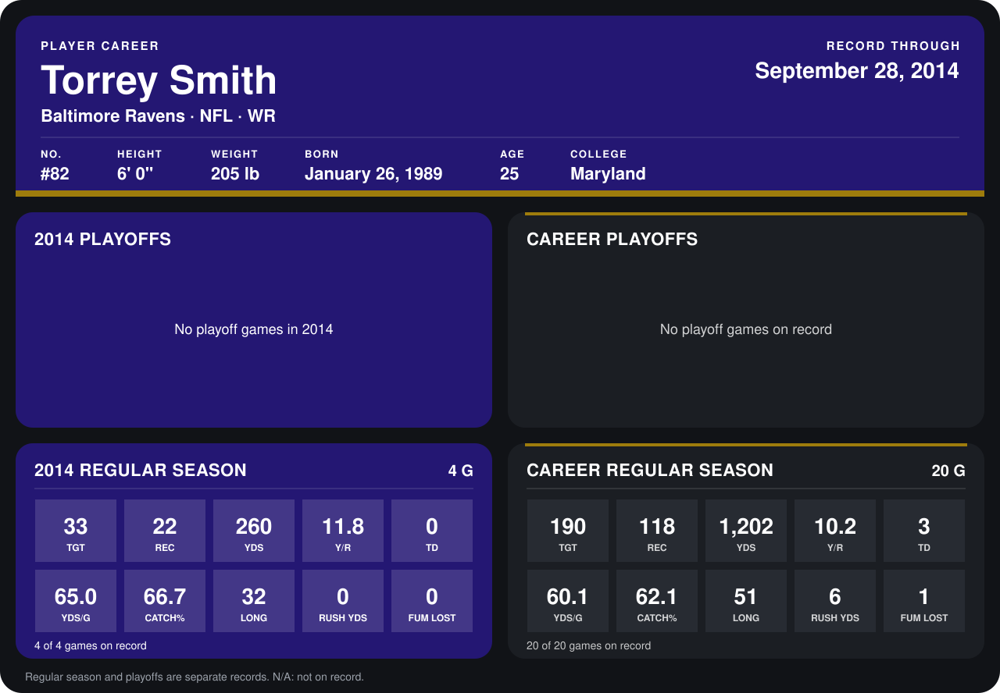

# Torrey Smith

## Career stats

### Regular season

| Season | Team | Age | # | G | TGT | REC | YDS | Y/R | TD | YDS/G | CATCH% | LONG | RUSH YDS | FUM LOST |
|---|---|---:|---:|---:|---:|---:|---:|---:|---:|---:|---:|---:|---:|---:|
| 2013 | Baltimore Ravens | 24 | 82 | 16 | 157 | 96 | 942 | 9.8 | 3 | 58.9 | 61.1 | 51 | 6 | 1 |
| 2014 | Baltimore Ravens | 25 | 82 | 4 | 33 | 22 | 260 | 11.8 | 0 | 65.0 | 66.7 | 32 | 0 | 0 |
| **Career** |  |  |  | 20 | 190 | 118 | 1,202 | 10.2 | 3 | 60.1 | 62.1 | 51 | 6 | 1 |

### Playoffs

No playoff games on record.

## Awards

None on record.

Age is his age on the league's opening game of each season; # is the number listed for him that season with that team (2014: the card's rule; 2013: the 2013 season roster), N/A where no listing applies.

Records through September 28, 2014. Identity: listed 2014 roster data, Weeks 1-4; number: 2014 Week 1 roster. [All Baltimore Ravens players](README.md).
