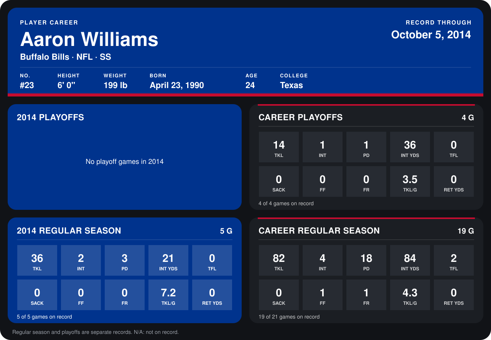

# Aaron Williams

## Career stats

### Regular season

| Season | Club | G | TKL | INT | PD | INT YDS | TFL | SACK | FF | FR | TKL/G | RET YDS |
|---|---|---:|---:|---:|---:|---:|---:|---:|---:|---:|---:|---:|
| 2013 | Buffalo Bills | 14 | 46 | 2 | 15 | 63 | 2 | 0 | 1 | 1 | 3.3 | 0 |
| 2014 | Buffalo Bills | 4 | 33 | 2 | 3 | 21 | 0 | 0 | 0 | 0 | 8.2 | 0 |
| **Career** |  | 18 | 79 | 4 | 18 | 84 | 2 | 0 | 1 | 1 | 4.4 | 0 |

### Playoffs

| Season | Club | G | TKL | INT | PD | INT YDS | TFL | SACK | FF | FR | TKL/G | RET YDS |
|---|---|---:|---:|---:|---:|---:|---:|---:|---:|---:|---:|---:|
| 2013 | Buffalo Bills | 4 | 14 | 1 | 1 | 36 | 0 | 0 | 0 | 0 | 3.5 | 0 |
| **Career** |  | 4 | 14 | 1 | 1 | 36 | 0 | 0 | 0 | 0 | 3.5 | 0 |

## Awards

- AFC Defensive Player of the Week (2014, Week 3)

Records through September 28, 2014. Identity: listed 2014 roster data, Weeks 1-4; number: 2014 Week 1 roster. [All Buffalo Bills players](README.md).
