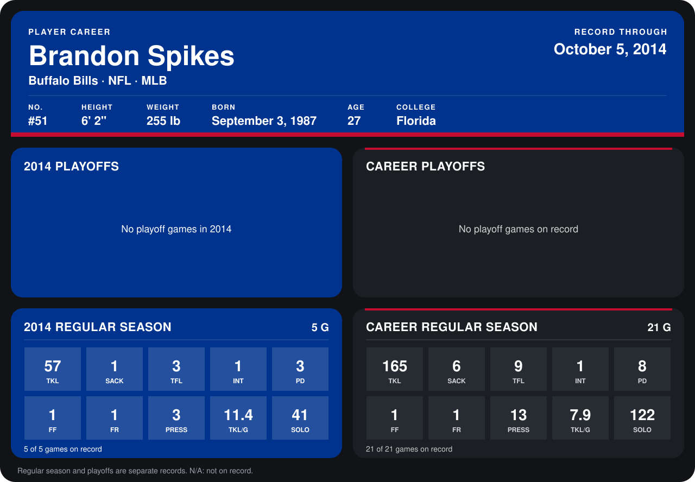

# Brandon Spikes

## Career stats

### Regular season

| Season | Team | Age | # | G | TKL | SACK | TFL | INT | PD | FF | FR | PRESS | TKL/G | SOLO |
|---|---|---:|---:|---:|---:|---:|---:|---:|---:|---:|---:|---:|---:|---:|
| 2013 | New England Patriots | 26 | 55 | 16 | 108 | 5 | 6 | 0 | 5 | 0 | 0 | 10 | 6.8 | 81 |
| 2014 | Buffalo Bills | 27 | 51 | 4 | 46 | 1 | 1 | 1 | 2 | 1 | 1 | 3 | 11.5 | 33 |
| **Career** |  |  |  | 20 | 154 | 6 | 7 | 1 | 7 | 1 | 1 | 13 | 7.7 | 114 |

### Playoffs

No playoff games on record.

## Awards

None on record.

Age is his age on the league's opening game of each season; # is the number listed for him that season with that team (2014: the card's rule; 2013: the 2013 season roster), N/A where no listing applies.

Records through September 28, 2014. Identity: listed 2014 roster data, Weeks 1-4; number: 2014 Week 1 roster. [All Buffalo Bills players](README.md).
