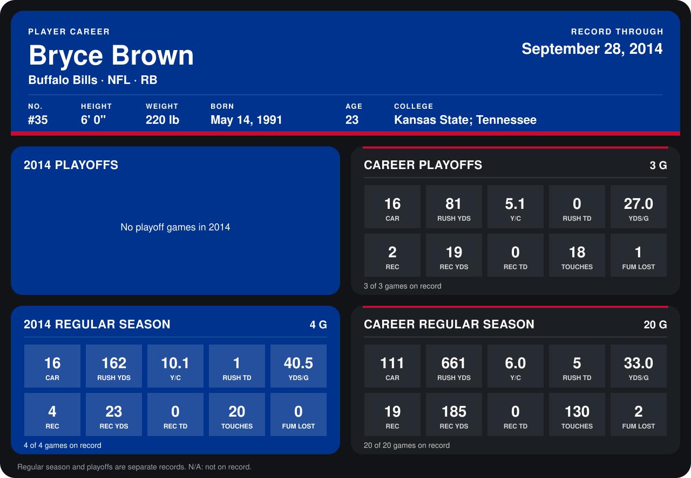

# Bryce Brown

## Career stats

### Regular season

| Season | Club | G | CAR | RUSH YDS | Y/C | RUSH TD | YDS/G | REC | REC YDS | REC TD | TOUCHES | FUM LOST |
|---|---|---:|---:|---:|---:|---:|---:|---:|---:|---:|---:|---:|
| 2013 | Philadelphia Eagles | 16 | 95 | 499 | 5.3 | 4 | 31.2 | 15 | 162 | 0 | 110 | 2 |
| 2014 | Buffalo Bills | 4 | 16 | 162 | 10.1 | 1 | 40.5 | 4 | 23 | 0 | 20 | 0 |
| **Career** |  | 20 | 111 | 661 | 6.0 | 5 | 33.0 | 19 | 185 | 0 | 130 | 2 |

### Playoffs

| Season | Club | G | CAR | RUSH YDS | Y/C | RUSH TD | YDS/G | REC | REC YDS | REC TD | TOUCHES | FUM LOST |
|---|---|---:|---:|---:|---:|---:|---:|---:|---:|---:|---:|---:|
| 2013 | Philadelphia Eagles | 3 | 16 | 81 | 5.1 | 0 | 27.0 | 2 | 19 | 0 | 18 | 1 |
| **Career** |  | 3 | 16 | 81 | 5.1 | 0 | 27.0 | 2 | 19 | 0 | 18 | 1 |

## Awards

None on record.

Records through September 28, 2014. Identity: listed 2014 roster data, Weeks 1-4; number: 2014 Week 1 roster. [All Buffalo Bills players](README.md).
