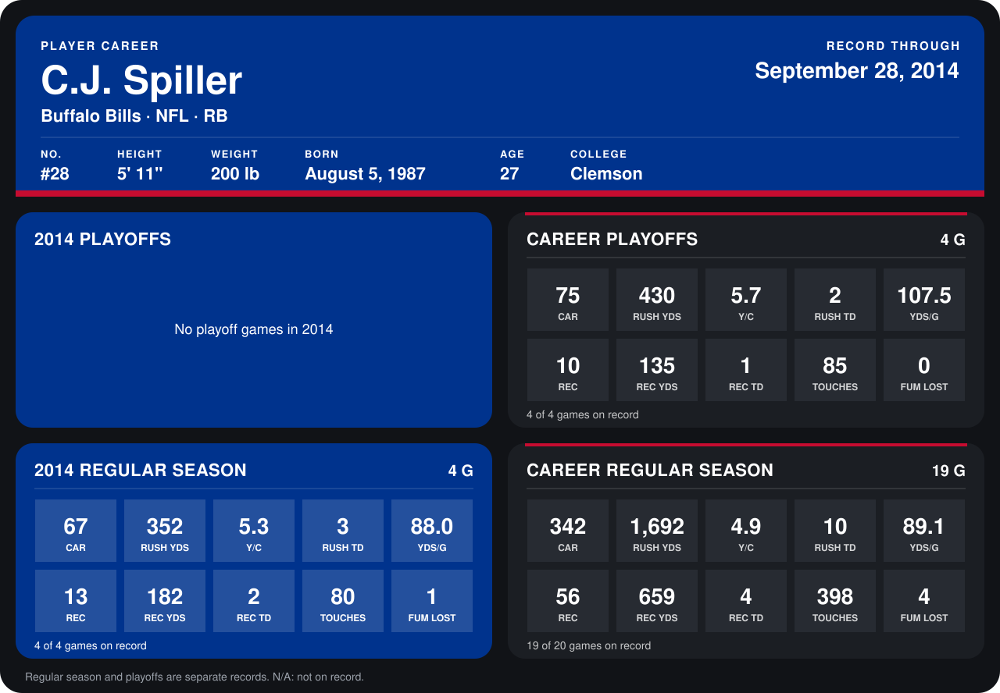

# C.J. Spiller

## Career stats

### Regular season

| Season | Team | Age | # | G | CAR | RUSH YDS | Y/C | RUSH TD | YDS/G | REC | REC YDS | REC TD | TOUCHES | FUM LOST |
|---|---|---:|---:|---:|---:|---:|---:|---:|---:|---:|---:|---:|---:|---:|
| 2013 | Buffalo Bills | 26 | 28 | 15 | 275 | 1,340 | 4.9 | 7 | 89.3 | 43 | 477 | 2 | 318 | 3 |
| 2014 | Buffalo Bills | 27 | 28 | 4 | 67 | 352 | 5.3 | 3 | 88.0 | 13 | 182 | 2 | 80 | 1 |
| **Career** |  |  |  | 19 | 342 | 1,692 | 4.9 | 10 | 89.1 | 56 | 659 | 4 | 398 | 4 |

### Playoffs

| Season | Team | Age | # | G | CAR | RUSH YDS | Y/C | RUSH TD | YDS/G | REC | REC YDS | REC TD | TOUCHES | FUM LOST |
|---|---|---:|---:|---:|---:|---:|---:|---:|---:|---:|---:|---:|---:|---:|
| 2013 | Buffalo Bills | 26 | 28 | 4 | 75 | 430 | 5.7 | 2 | 107.5 | 10 | 135 | 1 | 85 | 0 |
| **Career** |  |  |  | 4 | 75 | 430 | 5.7 | 2 | 107.5 | 10 | 135 | 1 | 85 | 0 |

## Awards

- AFC Offensive Player of the Week (2013, Week 3)
- AFC Offensive Player of the Week (2013, Week 15)
- Super Bowl MVP (2013 season)
- AFC Offensive Player of the Week (2014, Week 4)

Age is his age on the league's opening game of each season; # is the number listed for him that season with that team (2014: the card's rule; 2013: the 2013 season roster), N/A where no listing applies.

Records through September 28, 2014. Identity: listed 2014 roster data, Weeks 1-4; number: 2014 Week 1 roster. [All Buffalo Bills players](README.md).
