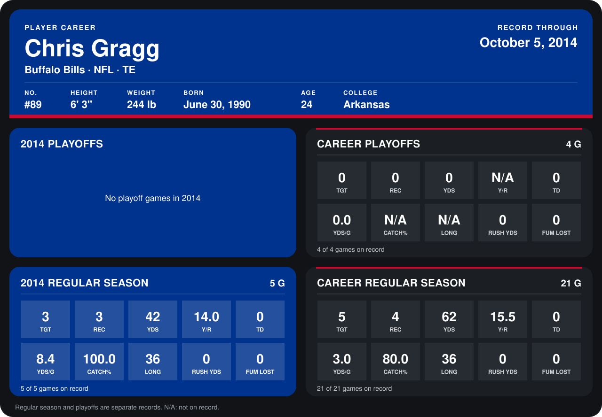

# Chris Gragg

## Career stats

### Regular season

| Season | Club | G | TGT | REC | YDS | Y/R | TD | YDS/G | CATCH% | LONG | RUSH YDS | FUM LOST |
|---|---|---:|---:|---:|---:|---:|---:|---:|---:|---:|---:|---:|
| 2013 | Buffalo Bills | 16 | 2 | 1 | 20 | 20.0 | 0 | 1.2 | 50.0 | 20 | 0 | 0 |
| 2014 | Buffalo Bills | 5 | 3 | 3 | 42 | 14.0 | 0 | 8.4 | 100.0 | 36 | 0 | 0 |
| **Career** |  | 21 | 5 | 4 | 62 | 15.5 | 0 | 3.0 | 80.0 | 36 | 0 | 0 |

### Playoffs

| Season | Club | G | TGT | REC | YDS | Y/R | TD | YDS/G | CATCH% | LONG | RUSH YDS | FUM LOST |
|---|---|---:|---:|---:|---:|---:|---:|---:|---:|---:|---:|---:|
| 2013 | Buffalo Bills | 4 | 0 | 0 | 0 | N/A | 0 | 0.0 | N/A | N/A | 0 | 0 |
| **Career** |  | 4 | 0 | 0 | 0 | N/A | 0 | 0.0 | N/A | N/A | 0 | 0 |

## Awards

None on record.

Records through October 5, 2014. Identity: listed 2014 roster data, Weeks 1-4; number: 2014 Week 1 roster. [All Buffalo Bills players](README.md).
