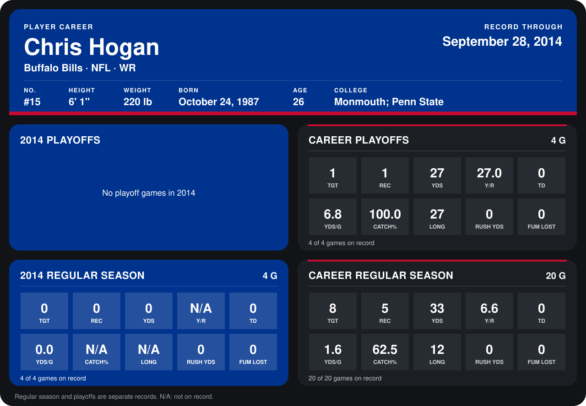

# Chris Hogan

## Career stats

### Regular season

| Season | Club | G | TGT | REC | YDS | Y/R | TD | YDS/G | CATCH% | LONG | RUSH YDS | FUM LOST |
|---|---|---:|---:|---:|---:|---:|---:|---:|---:|---:|---:|---:|
| 2013 | Buffalo Bills | 16 | 8 | 5 | 33 | 6.6 | 0 | 2.1 | 62.5 | 12 | 0 | 0 |
| 2014 | Buffalo Bills | 4 | 0 | 0 | 0 | N/A | 0 | 0.0 | N/A | N/A | 0 | 0 |
| **Career** |  | 20 | 8 | 5 | 33 | 6.6 | 0 | 1.6 | 62.5 | 12 | 0 | 0 |

### Playoffs

| Season | Club | G | TGT | REC | YDS | Y/R | TD | YDS/G | CATCH% | LONG | RUSH YDS | FUM LOST |
|---|---|---:|---:|---:|---:|---:|---:|---:|---:|---:|---:|---:|
| 2013 | Buffalo Bills | 4 | 1 | 1 | 27 | 27.0 | 0 | 6.8 | 100.0 | 27 | 0 | 0 |
| **Career** |  | 4 | 1 | 1 | 27 | 27.0 | 0 | 6.8 | 100.0 | 27 | 0 | 0 |

## Awards

None on record.

Records through September 28, 2014. Identity: listed 2014 roster data, Weeks 1-4; number: 2014 Week 1 roster. [All Buffalo Bills players](README.md).
