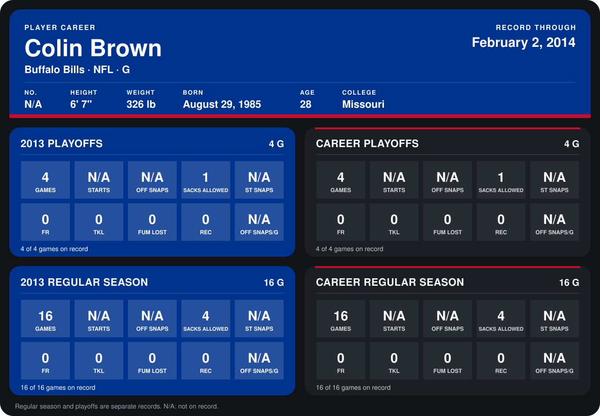

# Colin Brown

## Career stats

### Regular season

| Season | Club | G | STARTS | OFF SNAPS | SACKS ALLOWED | ST SNAPS | FR | TKL | FUM LOST | REC | OFF SNAPS/G |
|---|---|---:|---:|---:|---:|---:|---:|---:|---:|---:|---:|
| 2013 | Buffalo Bills | 16 | N/A | N/A | 4 | N/A | 0 | 0 | 0 | 0 | N/A |
| **Career** |  | 16 | N/A | N/A | 4 | N/A | 0 | 0 | 0 | 0 | N/A |

### Playoffs

| Season | Club | G | STARTS | OFF SNAPS | SACKS ALLOWED | ST SNAPS | FR | TKL | FUM LOST | REC | OFF SNAPS/G |
|---|---|---:|---:|---:|---:|---:|---:|---:|---:|---:|---:|
| 2013 | Buffalo Bills | 4 | N/A | N/A | 1 | N/A | 0 | 0 | 0 | 0 | N/A |
| **Career** |  | 4 | N/A | N/A | 1 | N/A | 0 | 0 | 0 | 0 | N/A |

## Awards

- Pro Bowl selection (2013, G)

Records through September 29, 2014. Identity: the public player file's latest listing (no 2014 Weeks 1-4 roster row). [All Buffalo Bills players](README.md).
