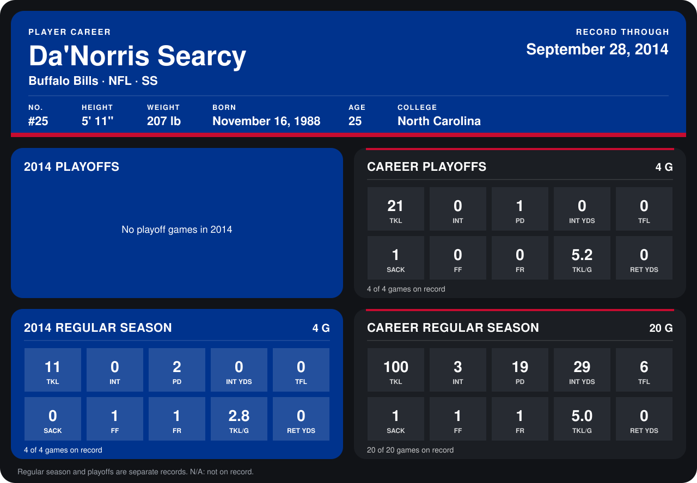

# Da'Norris Searcy

## Career stats

### Regular season

| Season | Club | G | TKL | INT | PD | INT YDS | TFL | SACK | FF | FR | TKL/G | RET YDS |
|---|---|---:|---:|---:|---:|---:|---:|---:|---:|---:|---:|---:|
| 2013 | Buffalo Bills | 16 | 89 | 3 | 17 | 29 | 6 | 1 | 0 | 0 | 5.6 | 0 |
| 2014 | Buffalo Bills | 5 | 12 | 0 | 3 | 0 | 0 | 0 | 1 | 1 | 2.4 | 0 |
| **Career** |  | 21 | 101 | 3 | 20 | 29 | 6 | 1 | 1 | 1 | 4.8 | 0 |

### Playoffs

| Season | Club | G | TKL | INT | PD | INT YDS | TFL | SACK | FF | FR | TKL/G | RET YDS |
|---|---|---:|---:|---:|---:|---:|---:|---:|---:|---:|---:|---:|
| 2013 | Buffalo Bills | 4 | 21 | 0 | 1 | 0 | 0 | 1 | 0 | 0 | 5.2 | 0 |
| **Career** |  | 4 | 21 | 0 | 1 | 0 | 0 | 1 | 0 | 0 | 5.2 | 0 |

## Awards

None on record.

Records through October 5, 2014. Identity: listed 2014 roster data, Weeks 1-4; number: 2014 Week 1 roster. [All Buffalo Bills players](README.md).
