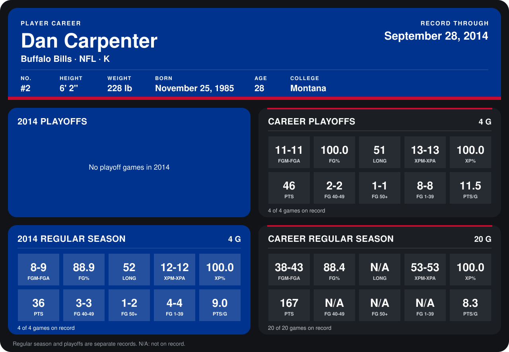

# Dan Carpenter

## Career stats

### Regular season

| Season | Team | Age | # | G | FGM-FGA | FG% | LONG | XPM-XPA | XP% | PTS | FG 40-49 | FG 50+ | FG 1-39 | PTS/G |
|---|---|---:|---:|---:|---:|---:|---:|---:|---:|---:|---:|---:|---:|---:|
| 2013 | Buffalo Bills | 27 | 2 | 16 | 30-34 | 88.2 | N/A | 41-41 | 100.0 | 131 | N/A | N/A | N/A | 8.2 |
| 2014 | Buffalo Bills | 28 | 2 | 5 | 10-12 | 83.3 | 52 | 15-15 | 100.0 | 45 | 3-3 | 2-4 | 5-5 | 9.0 |
| **Career** |  |  |  | 21 | 40-46 | 87.0 | N/A | 56-56 | 100.0 | 176 | N/A | N/A | N/A | 8.4 |

### Playoffs

| Season | Team | Age | # | G | FGM-FGA | FG% | LONG | XPM-XPA | XP% | PTS | FG 40-49 | FG 50+ | FG 1-39 | PTS/G |
|---|---|---:|---:|---:|---:|---:|---:|---:|---:|---:|---:|---:|---:|---:|
| 2013 | Buffalo Bills | 27 | 2 | 4 | 11-11 | 100.0 | 51 | 13-13 | 100.0 | 46 | 2-2 | 1-1 | 8-8 | 11.5 |
| **Career** |  |  |  | 4 | 11-11 | 100.0 | 51 | 13-13 | 100.0 | 46 | 2-2 | 1-1 | 8-8 | 11.5 |

## Awards

- AFC Special Teams Player of the Month (2013, December)

Age is his age on the league's opening game of each season; # is the number listed for him that season with that team (2014: the card's rule; 2013: the 2013 season roster), N/A where no listing applies.

Records through October 5, 2014. Identity: listed 2014 roster data, Weeks 1-4; number: 2014 Week 1 roster. [All Buffalo Bills players](README.md).
