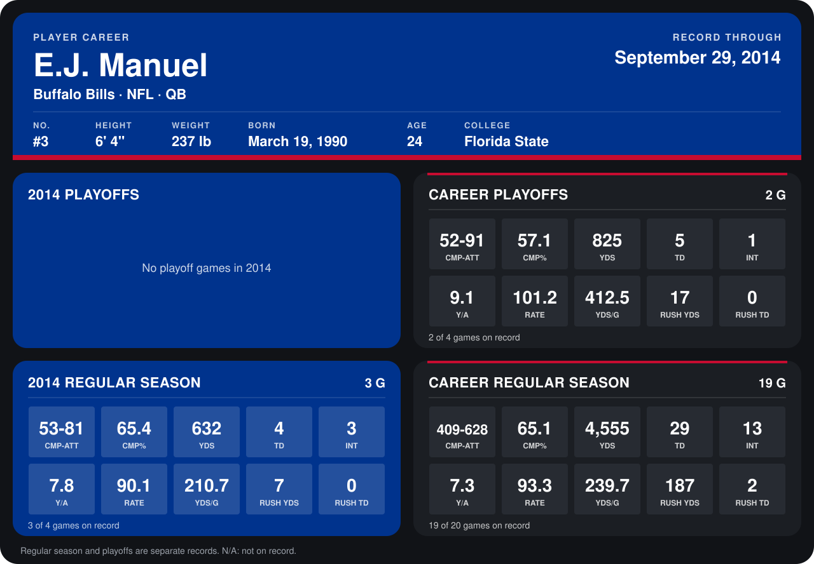

# E.J. Manuel

## Career stats

### Regular season

| Season | Club | G | CMP-ATT | CMP% | YDS | TD | INT | Y/A | RATE | YDS/G | RUSH YDS | RUSH TD |
|---|---|---:|---:|---:|---:|---:|---:|---:|---:|---:|---:|---:|
| 2013 | Buffalo Bills | 16 | 356-547 | 65.1 | 3,923 | 25 | 10 | 7.2 | 93.8 | 245.2 | 180 | 2 |
| 2014 | Buffalo Bills | 3 | 53-81 | 65.4 | 632 | 4 | 3 | 7.8 | 90.1 | 210.7 | 7 | 0 |
| **Career** |  | 19 | 409-628 | 65.1 | 4,555 | 29 | 13 | 7.3 | 93.3 | 239.7 | 187 | 2 |

### Playoffs

| Season | Club | G | CMP-ATT | CMP% | YDS | TD | INT | Y/A | RATE | YDS/G | RUSH YDS | RUSH TD |
|---|---|---:|---:|---:|---:|---:|---:|---:|---:|---:|---:|---:|
| 2013 | Buffalo Bills | 2 | 52-91 | 57.1 | 825 | 5 | 1 | 9.1 | 101.2 | 412.5 | 17 | 0 |
| **Career** |  | 2 | 52-91 | 57.1 | 825 | 5 | 1 | 9.1 | 101.2 | 412.5 | 17 | 0 |

## Awards

- Pro Bowl selection (2013, QB)

Records through October 5, 2014. Identity: listed 2014 roster data, Weeks 1-4; number: 2014 Week 1 roster. [All Buffalo Bills players](README.md).
