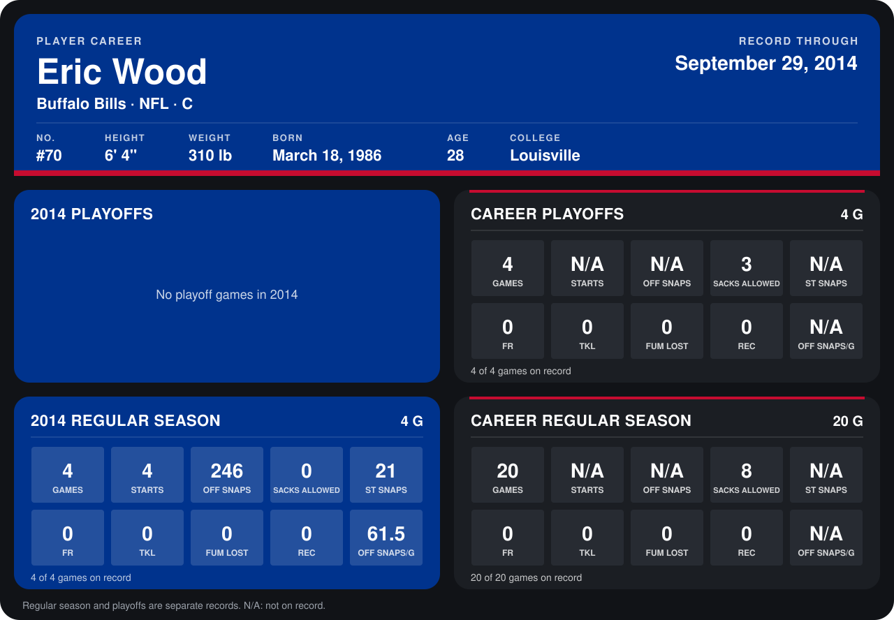

# Eric Wood

## Career stats

### Regular season

| Season | Club | G | STARTS | OFF SNAPS | SACKS ALLOWED | ST SNAPS | FR | TKL | FUM LOST | REC | OFF SNAPS/G |
|---|---|---:|---:|---:|---:|---:|---:|---:|---:|---:|---:|
| 2013 | Buffalo Bills | 16 | N/A | N/A | 8 | N/A | 0 | 0 | 0 | 0 | N/A |
| 2014 | Buffalo Bills | 4 | 4 | 246 | 0 | 21 | 0 | 0 | 0 | 0 | 61.5 |
| **Career** |  | 20 | N/A | N/A | 8 | N/A | 0 | 0 | 0 | 0 | N/A |

### Playoffs

| Season | Club | G | STARTS | OFF SNAPS | SACKS ALLOWED | ST SNAPS | FR | TKL | FUM LOST | REC | OFF SNAPS/G |
|---|---|---:|---:|---:|---:|---:|---:|---:|---:|---:|---:|
| 2013 | Buffalo Bills | 4 | N/A | N/A | 3 | N/A | 0 | 0 | 0 | 0 | N/A |
| **Career** |  | 4 | N/A | N/A | 3 | N/A | 0 | 0 | 0 | 0 | N/A |

## Awards

- Pro Bowl selection (2013, C)

Records through September 29, 2014. Identity: listed 2014 roster data, Weeks 1-4; number: 2014 Week 1 roster. [All Buffalo Bills players](README.md).
