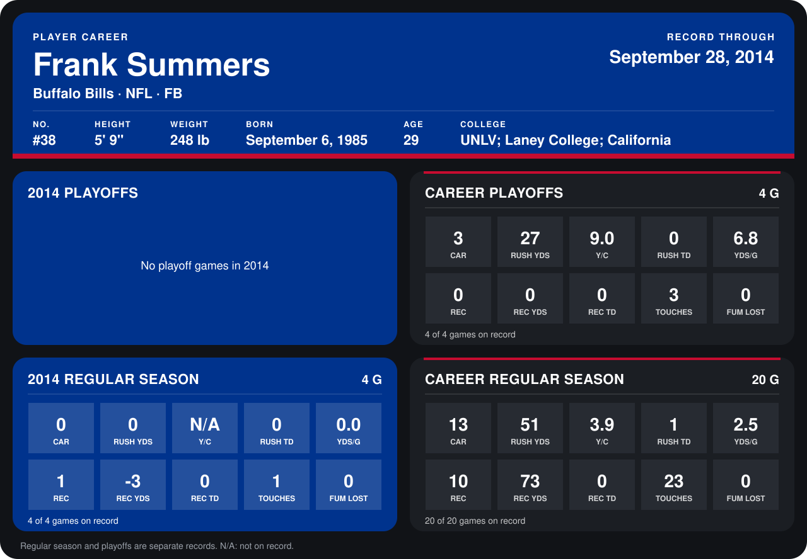

# Frank Summers

## Career stats

### Regular season

| Season | Club | G | CAR | RUSH YDS | Y/C | RUSH TD | YDS/G | REC | REC YDS | REC TD | TOUCHES | FUM LOST |
|---|---|---:|---:|---:|---:|---:|---:|---:|---:|---:|---:|---:|
| 2013 | Buffalo Bills | 16 | 13 | 51 | 3.9 | 1 | 3.2 | 9 | 76 | 0 | 22 | 0 |
| 2014 | Buffalo Bills | 4 | 0 | 0 | N/A | 0 | 0.0 | 1 | -3 | 0 | 1 | 0 |
| **Career** |  | 20 | 13 | 51 | 3.9 | 1 | 2.5 | 10 | 73 | 0 | 23 | 0 |

### Playoffs

| Season | Club | G | CAR | RUSH YDS | Y/C | RUSH TD | YDS/G | REC | REC YDS | REC TD | TOUCHES | FUM LOST |
|---|---|---:|---:|---:|---:|---:|---:|---:|---:|---:|---:|---:|
| 2013 | Buffalo Bills | 4 | 3 | 27 | 9.0 | 0 | 6.8 | 0 | 0 | 0 | 3 | 0 |
| **Career** |  | 4 | 3 | 27 | 9.0 | 0 | 6.8 | 0 | 0 | 0 | 3 | 0 |

## Awards

None on record.

Records through September 29, 2014. Identity: listed 2014 roster data, Weeks 1-4; number: 2014 Week 1 roster. [All Buffalo Bills players](README.md).
