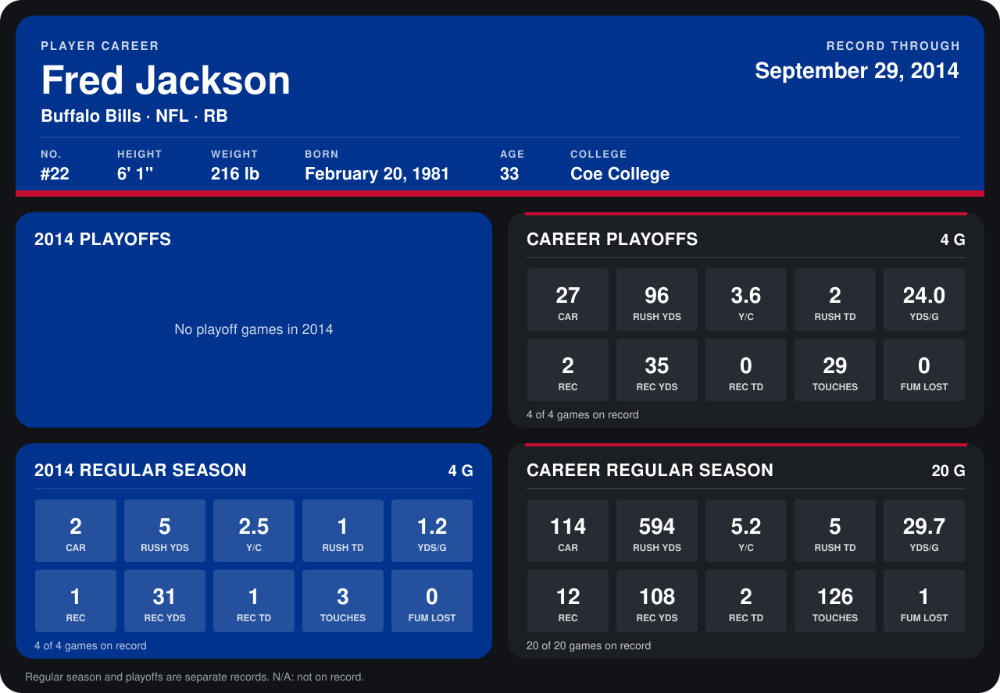

# Fred Jackson

## Career stats

### Regular season

| Season | Club | G | CAR | RUSH YDS | Y/C | RUSH TD | YDS/G | REC | REC YDS | REC TD | TOUCHES | FUM LOST |
|---|---|---:|---:|---:|---:|---:|---:|---:|---:|---:|---:|---:|
| 2013 | Buffalo Bills | 16 | 112 | 589 | 5.3 | 4 | 36.8 | 11 | 77 | 1 | 123 | 1 |
| 2014 | Buffalo Bills | 4 | 2 | 5 | 2.5 | 1 | 1.2 | 1 | 31 | 1 | 3 | 0 |
| **Career** |  | 20 | 114 | 594 | 5.2 | 5 | 29.7 | 12 | 108 | 2 | 126 | 1 |

### Playoffs

| Season | Club | G | CAR | RUSH YDS | Y/C | RUSH TD | YDS/G | REC | REC YDS | REC TD | TOUCHES | FUM LOST |
|---|---|---:|---:|---:|---:|---:|---:|---:|---:|---:|---:|---:|
| 2013 | Buffalo Bills | 4 | 27 | 96 | 3.6 | 2 | 24.0 | 2 | 35 | 0 | 29 | 0 |
| **Career** |  | 4 | 27 | 96 | 3.6 | 2 | 24.0 | 2 | 35 | 0 | 29 | 0 |

## Awards

None on record.

Records through September 28, 2014. Identity: listed 2014 roster data, Weeks 1-4; number: 2014 Week 1 roster. [All Buffalo Bills players](README.md).
