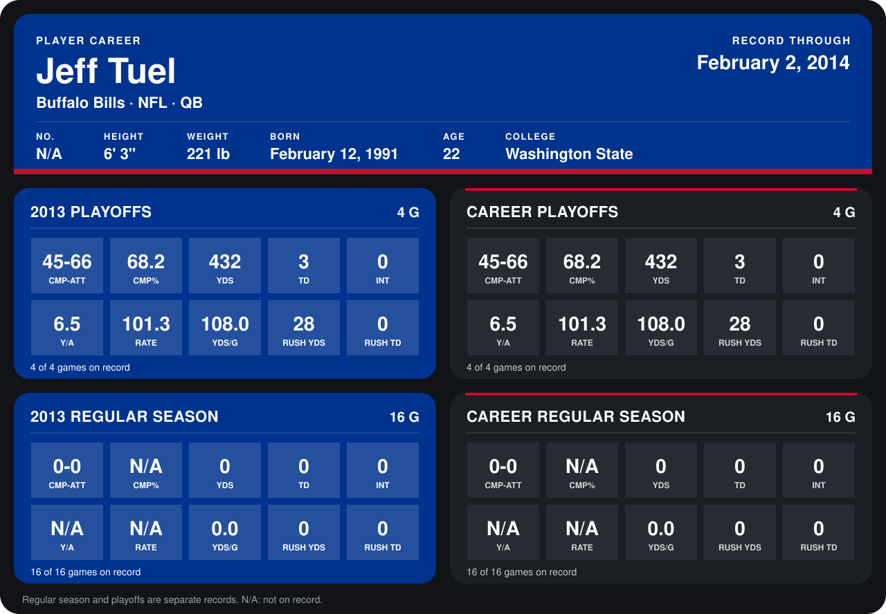

# Jeff Tuel

## Career stats

### Regular season

| Season | Club | G | CMP-ATT | CMP% | YDS | TD | INT | Y/A | RATE | YDS/G | RUSH YDS | RUSH TD |
|---|---|---:|---:|---:|---:|---:|---:|---:|---:|---:|---:|---:|
| 2013 | Buffalo Bills | 16 | 0-0 | N/A | 0 | 0 | 0 | N/A | N/A | 0.0 | 0 | 0 |
| **Career** |  | 16 | 0-0 | N/A | 0 | 0 | 0 | N/A | N/A | 0.0 | 0 | 0 |

### Playoffs

| Season | Club | G | CMP-ATT | CMP% | YDS | TD | INT | Y/A | RATE | YDS/G | RUSH YDS | RUSH TD |
|---|---|---:|---:|---:|---:|---:|---:|---:|---:|---:|---:|---:|
| 2013 | Buffalo Bills | 4 | 45-66 | 68.2 | 432 | 3 | 0 | 6.5 | 101.3 | 108.0 | 28 | 0 |
| **Career** |  | 4 | 45-66 | 68.2 | 432 | 3 | 0 | 6.5 | 101.3 | 108.0 | 28 | 0 |

## Awards

None on record.

Records through September 29, 2014. Identity: the public player file's latest listing (no 2014 Weeks 1-4 roster row). [All Buffalo Bills players](README.md).
