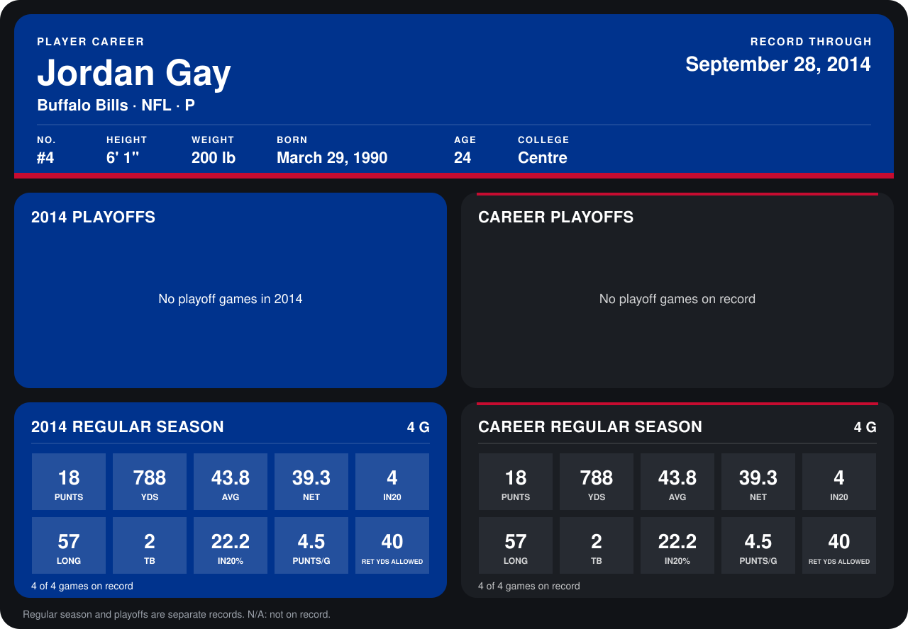

# Jordan Gay

## Career stats

### Regular season

| Season | Club | G | PUNTS | YDS | AVG | NET | IN20 | LONG | TB | IN20% | PUNTS/G | RET YDS ALLOWED |
|---|---|---:|---:|---:|---:|---:|---:|---:|---:|---:|---:|---:|
| 2014 | Buffalo Bills | 4 | 18 | 788 | 43.8 | 39.3 | 4 | 57 | 2 | 22.2 | 4.5 | 40 |
| **Career** |  | 4 | 18 | 788 | 43.8 | 39.3 | 4 | 57 | 2 | 22.2 | 4.5 | 40 |

### Playoffs

No playoff games on record.

## Awards

None on record.

Records through September 28, 2014. Identity: listed 2014 roster data, Weeks 1-4; number: 2014 Week 1 roster. [All Buffalo Bills players](README.md).
