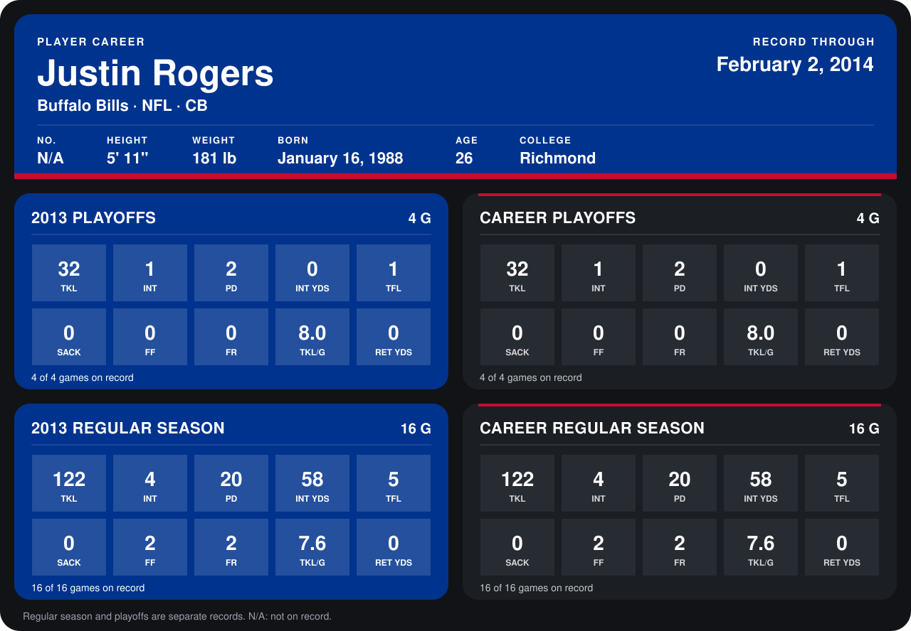

# Justin Rogers

## Career stats

### Regular season

| Season | Club | G | TKL | INT | PD | INT YDS | TFL | SACK | FF | FR | TKL/G | RET YDS |
|---|---|---:|---:|---:|---:|---:|---:|---:|---:|---:|---:|---:|
| 2013 | Buffalo Bills | 16 | 122 | 4 | 20 | 58 | 5 | 0 | 2 | 2 | 7.6 | 0 |
| **Career** |  | 16 | 122 | 4 | 20 | 58 | 5 | 0 | 2 | 2 | 7.6 | 0 |

### Playoffs

| Season | Club | G | TKL | INT | PD | INT YDS | TFL | SACK | FF | FR | TKL/G | RET YDS |
|---|---|---:|---:|---:|---:|---:|---:|---:|---:|---:|---:|---:|
| 2013 | Buffalo Bills | 4 | 32 | 1 | 2 | 0 | 1 | 0 | 0 | 0 | 8.0 | 0 |
| **Career** |  | 4 | 32 | 1 | 2 | 0 | 1 | 0 | 0 | 0 | 8.0 | 0 |

## Awards

- AFC Defensive Player of the Week (2013, Week 14)
- AP Second-Team All-Pro (2013, CB)
- Pro Bowl selection (2013, CB)

Records through September 29, 2014. Identity: the public player file's latest listing (no 2014 Weeks 1-4 roster row). [All Buffalo Bills players](README.md).
