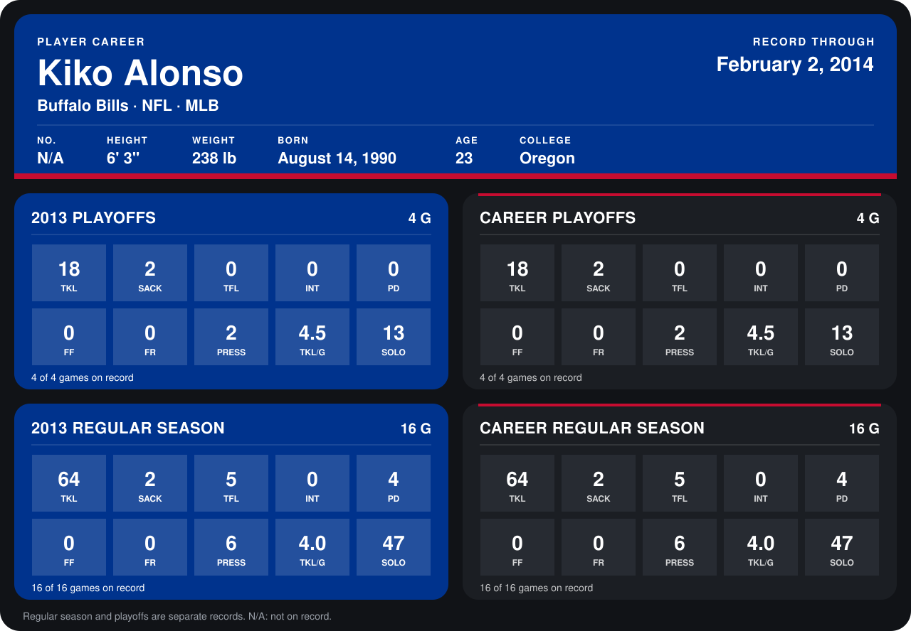

# Kiko Alonso

## Career stats

### Regular season

| Season | Club | G | TKL | SACK | TFL | INT | PD | FF | FR | PRESS | TKL/G | SOLO |
|---|---|---:|---:|---:|---:|---:|---:|---:|---:|---:|---:|---:|
| 2013 | Buffalo Bills | 16 | 64 | 2 | 5 | 0 | 4 | 0 | 0 | 6 | 4.0 | 47 |
| **Career** |  | 16 | 64 | 2 | 5 | 0 | 4 | 0 | 0 | 6 | 4.0 | 47 |

### Playoffs

| Season | Club | G | TKL | SACK | TFL | INT | PD | FF | FR | PRESS | TKL/G | SOLO |
|---|---|---:|---:|---:|---:|---:|---:|---:|---:|---:|---:|---:|
| 2013 | Buffalo Bills | 4 | 18 | 2 | 0 | 0 | 0 | 0 | 0 | 2 | 4.5 | 13 |
| **Career** |  | 4 | 18 | 2 | 0 | 0 | 0 | 0 | 0 | 2 | 4.5 | 13 |

## Awards

- AP Defensive Rookie of the Year (2013)

Records through September 29, 2014. Identity: the public player file's latest listing (no 2014 Weeks 1-4 roster row). [All Buffalo Bills players](README.md).
