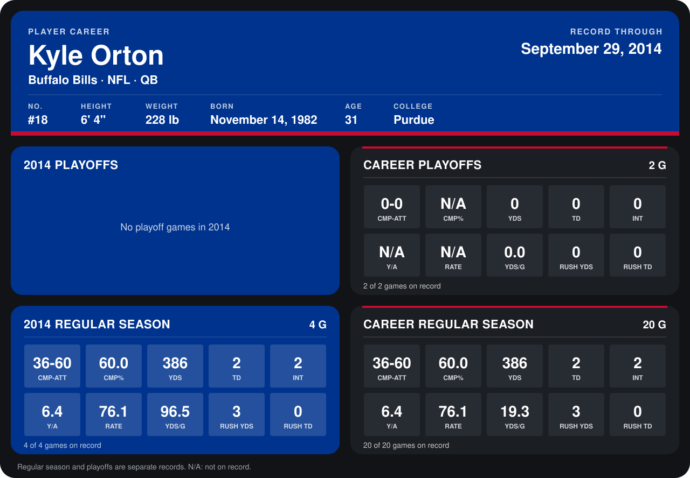

# Kyle Orton

## Career stats

### Regular season

| Season | Team | Age | # | G | CMP-ATT | CMP% | YDS | TD | INT | Y/A | RATE | YDS/G | RUSH YDS | RUSH TD |
|---|---|---:|---:|---:|---:|---:|---:|---:|---:|---:|---:|---:|---:|---:|
| 2013 | Dallas Cowboys | 30 | 18 | 16 | 0-0 | N/A | 0 | 0 | 0 | N/A | N/A | 0.0 | 0 | 0 |
| 2014 | Buffalo Bills | 31 | 18 | 5 | 55-90 | 61.1 | 664 | 5 | 2 | 7.4 | 93.0 | 132.8 | 3 | 0 |
| **Career** |  |  |  | 21 | 55-90 | 61.1 | 664 | 5 | 2 | 7.4 | 93.0 | 31.6 | 3 | 0 |

### Playoffs

| Season | Team | Age | # | G | CMP-ATT | CMP% | YDS | TD | INT | Y/A | RATE | YDS/G | RUSH YDS | RUSH TD |
|---|---|---:|---:|---:|---:|---:|---:|---:|---:|---:|---:|---:|---:|---:|
| 2013 | Dallas Cowboys | 30 | 18 | 2 | 0-0 | N/A | 0 | 0 | 0 | N/A | N/A | 0.0 | 0 | 0 |
| **Career** |  |  |  | 2 | 0-0 | N/A | 0 | 0 | 0 | N/A | N/A | 0.0 | 0 | 0 |

## Awards

None on record.

Age is his age on the league's opening game of each season; # is the number listed for him that season with that team (2014: the card's rule; 2013: the 2013 season roster), N/A where no listing applies.

Records through October 5, 2014. Identity: listed 2014 roster data, Weeks 1-4; number: 2014 Week 1 roster. [All Buffalo Bills players](README.md).
