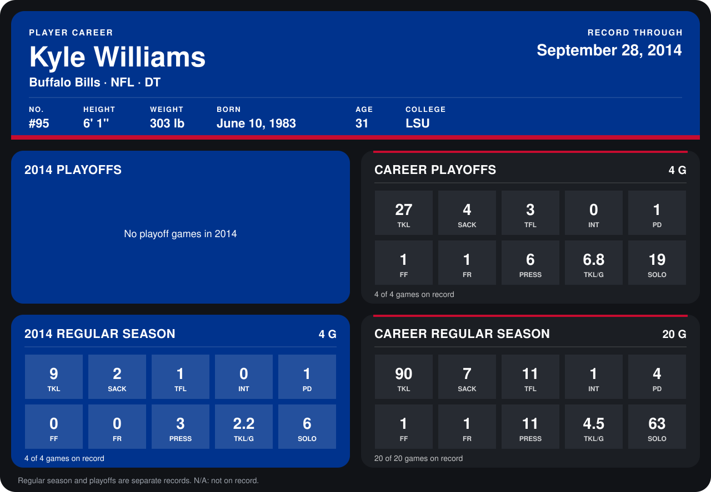

# Kyle Williams

## Career stats

### Regular season

| Season | Club | G | TKL | SACK | TFL | INT | PD | FF | FR | PRESS | TKL/G | SOLO |
|---|---|---:|---:|---:|---:|---:|---:|---:|---:|---:|---:|---:|
| 2013 | Buffalo Bills | 16 | 81 | 5 | 10 | 1 | 3 | 1 | 1 | 8 | 5.1 | 57 |
| 2014 | Buffalo Bills | 5 | 11 | 2 | 2 | 0 | 1 | 0 | 0 | 3 | 2.2 | 7 |
| **Career** |  | 21 | 92 | 7 | 12 | 1 | 4 | 1 | 1 | 11 | 4.4 | 64 |

### Playoffs

| Season | Club | G | TKL | SACK | TFL | INT | PD | FF | FR | PRESS | TKL/G | SOLO |
|---|---|---:|---:|---:|---:|---:|---:|---:|---:|---:|---:|---:|
| 2013 | Buffalo Bills | 4 | 27 | 4 | 3 | 0 | 1 | 1 | 1 | 6 | 6.8 | 19 |
| **Career** |  | 4 | 27 | 4 | 3 | 0 | 1 | 1 | 1 | 6 | 6.8 | 19 |

## Awards

None on record.

Records through October 5, 2014. Identity: listed 2014 roster data, Weeks 1-4; number: 2014 Week 1 roster. [All Buffalo Bills players](README.md).
