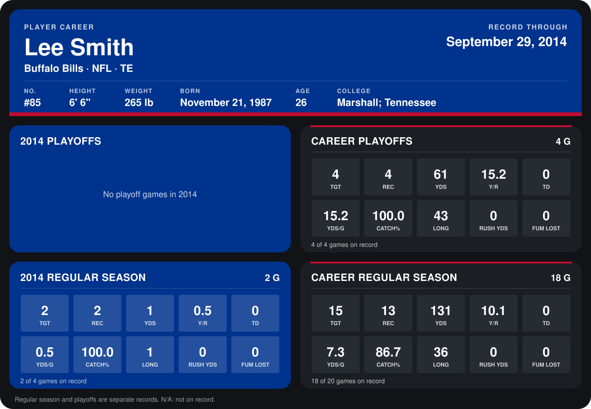

# Lee Smith

## Career stats

### Regular season

| Season | Club | G | TGT | REC | YDS | Y/R | TD | YDS/G | CATCH% | LONG | RUSH YDS | FUM LOST |
|---|---|---:|---:|---:|---:|---:|---:|---:|---:|---:|---:|---:|
| 2013 | Buffalo Bills | 16 | 13 | 11 | 130 | 11.8 | 0 | 8.1 | 84.6 | 36 | 0 | 0 |
| 2014 | Buffalo Bills | 2 | 2 | 2 | 1 | 0.5 | 0 | 0.5 | 100.0 | 1 | 0 | 0 |
| **Career** |  | 18 | 15 | 13 | 131 | 10.1 | 0 | 7.3 | 86.7 | 36 | 0 | 0 |

### Playoffs

| Season | Club | G | TGT | REC | YDS | Y/R | TD | YDS/G | CATCH% | LONG | RUSH YDS | FUM LOST |
|---|---|---:|---:|---:|---:|---:|---:|---:|---:|---:|---:|---:|
| 2013 | Buffalo Bills | 4 | 4 | 4 | 61 | 15.2 | 0 | 15.2 | 100.0 | 43 | 0 | 0 |
| **Career** |  | 4 | 4 | 4 | 61 | 15.2 | 0 | 15.2 | 100.0 | 43 | 0 | 0 |

## Awards

None on record.

Records through September 28, 2014. Identity: listed 2014 roster data, Weeks 1-4; number: 2014 Week 1 roster. [All Buffalo Bills players](README.md).
