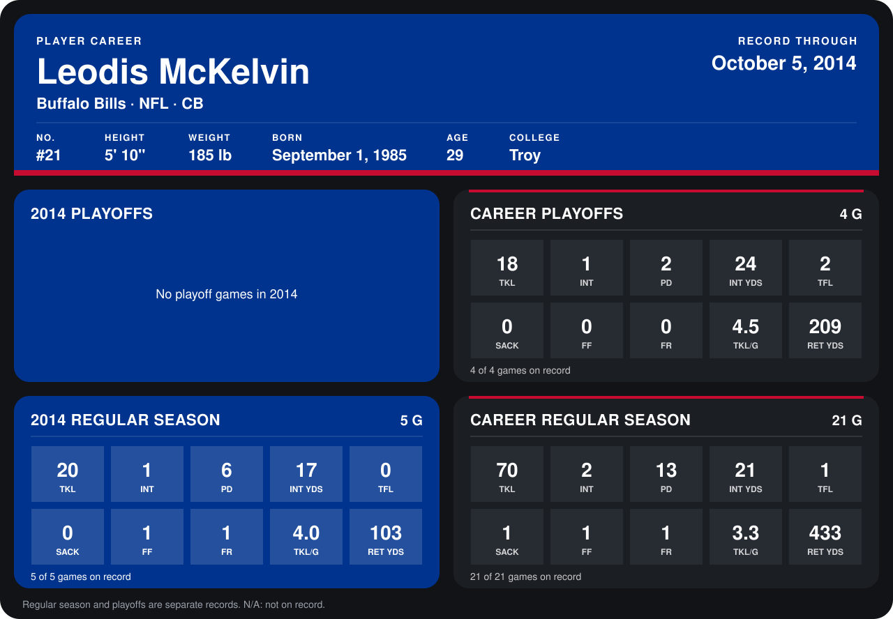

# Leodis McKelvin

## Career stats

### Regular season

| Season | Team | Age | # | G | TKL | INT | PD | INT YDS | TFL | SACK | FF | FR | TKL/G | RET YDS |
|---|---|---:|---:|---:|---:|---:|---:|---:|---:|---:|---:|---:|---:|---:|
| 2013 | Buffalo Bills | 28 | 21 | 16 | 50 | 1 | 7 | 4 | 1 | 1 | 0 | 0 | 3.1 | 330 |
| 2014 | Buffalo Bills | 29 | 21 | 5 | 20 | 1 | 6 | 17 | 0 | 0 | 1 | 1 | 4.0 | 103 |
| **Career** |  |  |  | 21 | 70 | 2 | 13 | 21 | 1 | 1 | 1 | 1 | 3.3 | 433 |

### Playoffs

| Season | Team | Age | # | G | TKL | INT | PD | INT YDS | TFL | SACK | FF | FR | TKL/G | RET YDS |
|---|---|---:|---:|---:|---:|---:|---:|---:|---:|---:|---:|---:|---:|---:|
| 2013 | Buffalo Bills | 28 | 21 | 4 | 18 | 1 | 2 | 24 | 2 | 0 | 0 | 0 | 4.5 | 209 |
| **Career** |  |  |  | 4 | 18 | 1 | 2 | 24 | 2 | 0 | 0 | 0 | 4.5 | 209 |

## Awards

None on record.

Age is his age on the league's opening game of each season; # is the number listed for him that season with that team (2014: the card's rule; 2013: the 2013 season roster), N/A where no listing applies.

Records through October 5, 2014. Identity: listed 2014 roster data, Weeks 1-4; number: 2014 Week 1 roster. [All Buffalo Bills players](README.md).
