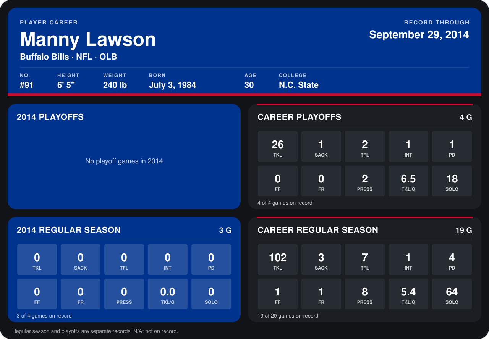

# Manny Lawson

## Career stats

### Regular season

| Season | Club | G | TKL | SACK | TFL | INT | PD | FF | FR | PRESS | TKL/G | SOLO |
|---|---|---:|---:|---:|---:|---:|---:|---:|---:|---:|---:|---:|
| 2013 | Buffalo Bills | 16 | 102 | 3 | 7 | 1 | 4 | 1 | 1 | 8 | 6.4 | 64 |
| 2014 | Buffalo Bills | 3 | 0 | 0 | 0 | 0 | 0 | 0 | 0 | 0 | 0.0 | 0 |
| **Career** |  | 19 | 102 | 3 | 7 | 1 | 4 | 1 | 1 | 8 | 5.4 | 64 |

### Playoffs

| Season | Club | G | TKL | SACK | TFL | INT | PD | FF | FR | PRESS | TKL/G | SOLO |
|---|---|---:|---:|---:|---:|---:|---:|---:|---:|---:|---:|---:|
| 2013 | Buffalo Bills | 4 | 26 | 1 | 2 | 1 | 1 | 0 | 0 | 2 | 6.5 | 18 |
| **Career** |  | 4 | 26 | 1 | 2 | 1 | 1 | 0 | 0 | 2 | 6.5 | 18 |

## Awards

None on record.

Records through September 29, 2014. Identity: listed 2014 roster data, Weeks 1-4; number: 2014 Week 1 roster. [All Buffalo Bills players](README.md).
