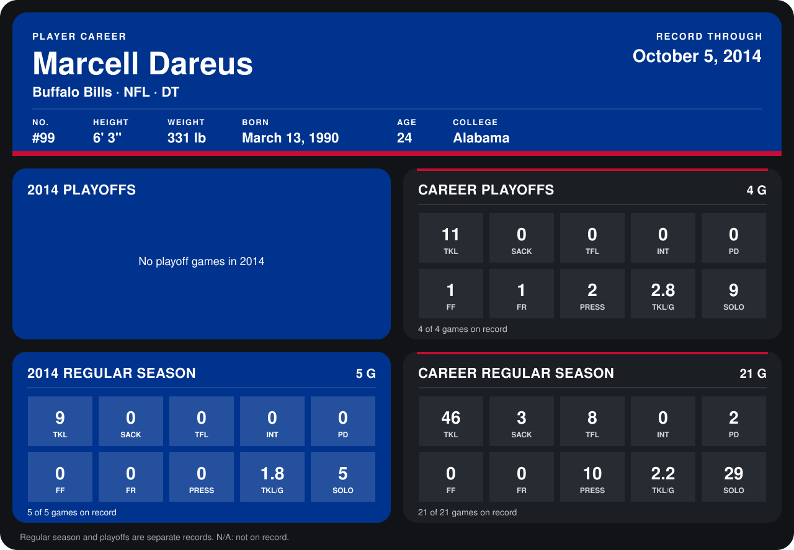

# Marcell Dareus

## Career stats

### Regular season

| Season | Team | Age | # | G | TKL | SACK | TFL | INT | PD | FF | FR | PRESS | TKL/G | SOLO |
|---|---|---:|---:|---:|---:|---:|---:|---:|---:|---:|---:|---:|---:|---:|
| 2013 | Buffalo Bills | 23 | 99 | 16 | 37 | 3 | 8 | 0 | 2 | 0 | 0 | 10 | 2.3 | 24 |
| 2014 | Buffalo Bills | 24 | 99 | 5 | 9 | 0 | 0 | 0 | 0 | 0 | 0 | 0 | 1.8 | 5 |
| **Career** |  |  |  | 21 | 46 | 3 | 8 | 0 | 2 | 0 | 0 | 10 | 2.2 | 29 |

### Playoffs

| Season | Team | Age | # | G | TKL | SACK | TFL | INT | PD | FF | FR | PRESS | TKL/G | SOLO |
|---|---|---:|---:|---:|---:|---:|---:|---:|---:|---:|---:|---:|---:|---:|
| 2013 | Buffalo Bills | 23 | 99 | 4 | 11 | 0 | 0 | 0 | 0 | 1 | 1 | 2 | 2.8 | 9 |
| **Career** |  |  |  | 4 | 11 | 0 | 0 | 0 | 0 | 1 | 1 | 2 | 2.8 | 9 |

## Awards

None on record.

Age is his age on the league's opening game of each season; # is the number listed for him that season with that team (2014: the card's rule; 2013: the 2013 season roster), N/A where no listing applies.

Records through October 5, 2014. Identity: listed 2014 roster data, Weeks 1-4; number: 2014 Week 1 roster. [All Buffalo Bills players](README.md).
