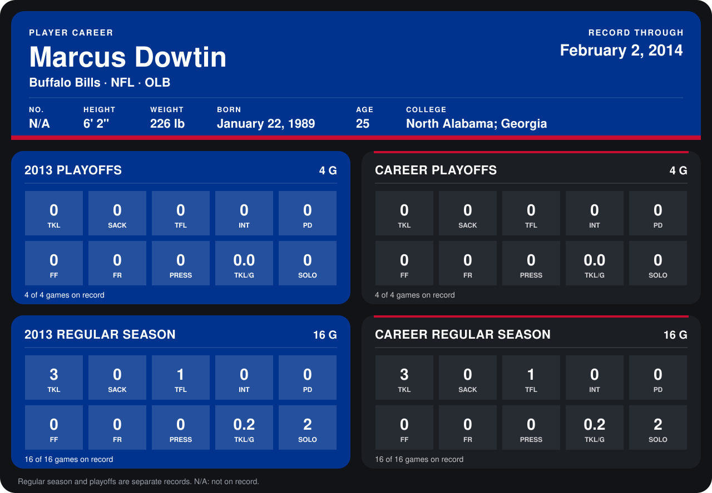

# Marcus Dowtin

## Career stats

### Regular season

| Season | Club | G | TKL | SACK | TFL | INT | PD | FF | FR | PRESS | TKL/G | SOLO |
|---|---|---:|---:|---:|---:|---:|---:|---:|---:|---:|---:|---:|
| 2013 | Buffalo Bills | 16 | 3 | 0 | 1 | 0 | 0 | 0 | 0 | 0 | 0.2 | 2 |
| **Career** |  | 16 | 3 | 0 | 1 | 0 | 0 | 0 | 0 | 0 | 0.2 | 2 |

### Playoffs

| Season | Club | G | TKL | SACK | TFL | INT | PD | FF | FR | PRESS | TKL/G | SOLO |
|---|---|---:|---:|---:|---:|---:|---:|---:|---:|---:|---:|---:|
| 2013 | Buffalo Bills | 4 | 0 | 0 | 0 | 0 | 0 | 0 | 0 | 0 | 0.0 | 0 |
| **Career** |  | 4 | 0 | 0 | 0 | 0 | 0 | 0 | 0 | 0 | 0.0 | 0 |

## Awards

None on record.

Records through February 2, 2014. Identity: his listed 2013 season roster data (no 2014 Weeks 1-4 roster row). [All Buffalo Bills players](README.md).
