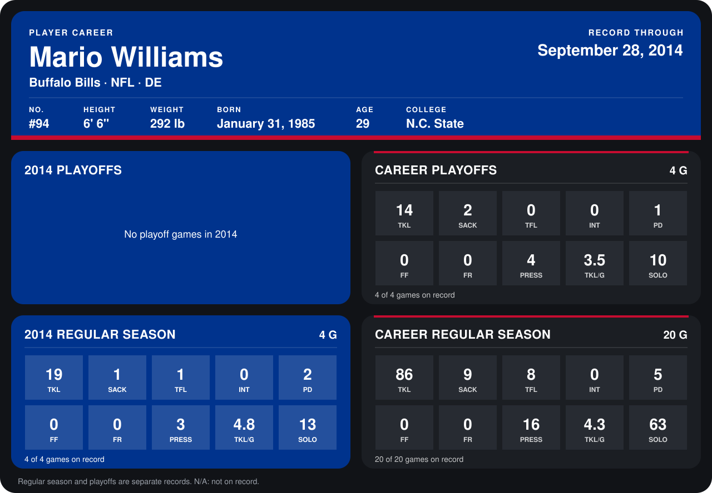

# Mario Williams

## Career stats

### Regular season

| Season | Club | G | TKL | SACK | TFL | INT | PD | FF | FR | PRESS | TKL/G | SOLO |
|---|---|---:|---:|---:|---:|---:|---:|---:|---:|---:|---:|---:|
| 2013 | Buffalo Bills | 16 | 67 | 8 | 7 | 0 | 3 | 0 | 0 | 13 | 4.2 | 50 |
| 2014 | Buffalo Bills | 4 | 19 | 1 | 1 | 0 | 2 | 0 | 0 | 3 | 4.8 | 13 |
| **Career** |  | 20 | 86 | 9 | 8 | 0 | 5 | 0 | 0 | 16 | 4.3 | 63 |

### Playoffs

| Season | Club | G | TKL | SACK | TFL | INT | PD | FF | FR | PRESS | TKL/G | SOLO |
|---|---|---:|---:|---:|---:|---:|---:|---:|---:|---:|---:|---:|
| 2013 | Buffalo Bills | 4 | 14 | 2 | 0 | 0 | 1 | 0 | 0 | 4 | 3.5 | 10 |
| **Career** |  | 4 | 14 | 2 | 0 | 0 | 1 | 0 | 0 | 4 | 3.5 | 10 |

## Awards

None on record.

Records through September 28, 2014. Identity: listed 2014 roster data, Weeks 1-4; number: 2014 Week 1 roster. [All Buffalo Bills players](README.md).
