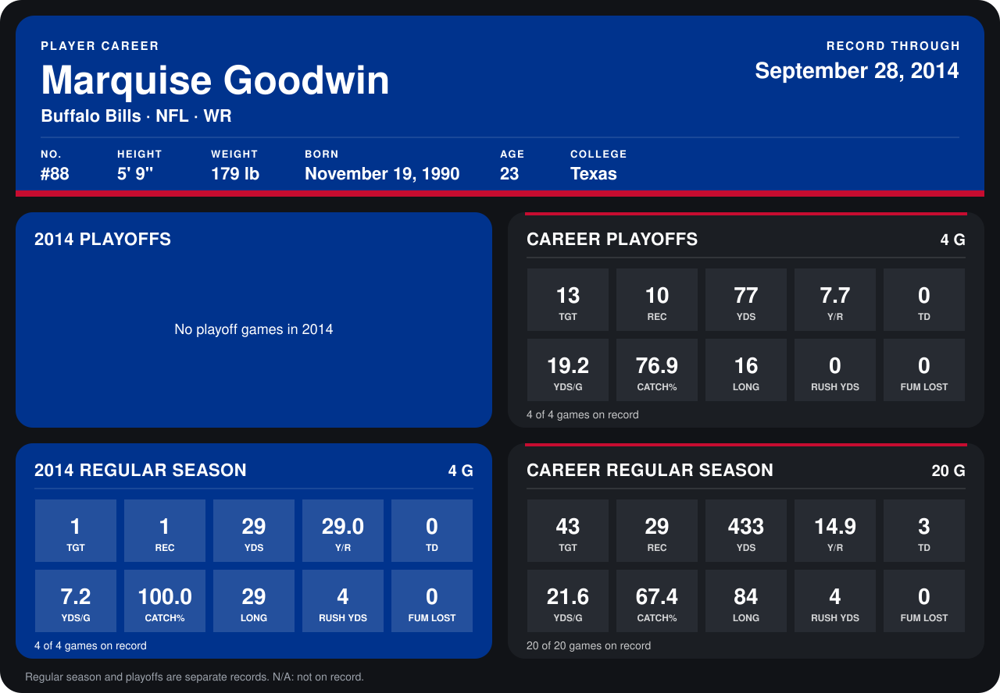

# Marquise Goodwin

## Career stats

### Regular season

| Season | Club | G | TGT | REC | YDS | Y/R | TD | YDS/G | CATCH% | LONG | RUSH YDS | FUM LOST |
|---|---|---:|---:|---:|---:|---:|---:|---:|---:|---:|---:|---:|
| 2013 | Buffalo Bills | 16 | 42 | 28 | 404 | 14.4 | 3 | 25.2 | 66.7 | 84 | 0 | 0 |
| 2014 | Buffalo Bills | 4 | 1 | 1 | 29 | 29.0 | 0 | 7.2 | 100.0 | 29 | 4 | 0 |
| **Career** |  | 20 | 43 | 29 | 433 | 14.9 | 3 | 21.6 | 67.4 | 84 | 4 | 0 |

### Playoffs

| Season | Club | G | TGT | REC | YDS | Y/R | TD | YDS/G | CATCH% | LONG | RUSH YDS | FUM LOST |
|---|---|---:|---:|---:|---:|---:|---:|---:|---:|---:|---:|---:|
| 2013 | Buffalo Bills | 4 | 13 | 10 | 77 | 7.7 | 0 | 19.2 | 76.9 | 16 | 0 | 0 |
| **Career** |  | 4 | 13 | 10 | 77 | 7.7 | 0 | 19.2 | 76.9 | 16 | 0 | 0 |

## Awards

- AFC Special Teams Player of the Week (2013, Week 17)

Records through September 29, 2014. Identity: listed 2014 roster data, Weeks 1-4; number: 2014 Week 1 roster. [All Buffalo Bills players](README.md).
