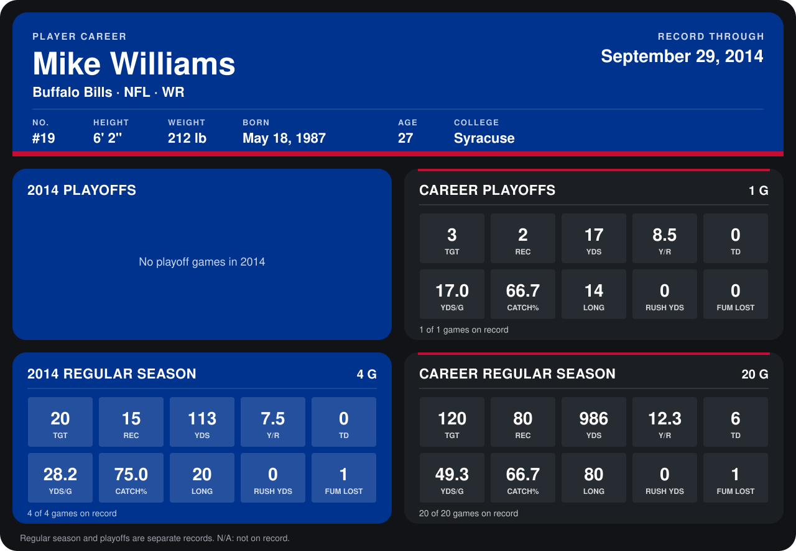

# Mike Williams

## Career stats

### Regular season

| Season | Team | Age | # | G | TGT | REC | YDS | Y/R | TD | YDS/G | CATCH% | LONG | RUSH YDS | FUM LOST |
|---|---|---:|---:|---:|---:|---:|---:|---:|---:|---:|---:|---:|---:|---:|
| 2013 | Tampa Bay Buccaneers | 26 | 19 | 16 | 100 | 65 | 873 | 13.4 | 6 | 54.6 | 65.0 | 80 | 0 | 0 |
| 2014 | Buffalo Bills | 27 | 19 | 5 | 22 | 16 | 126 | 7.9 | 0 | 25.2 | 72.7 | 20 | 0 | 1 |
| **Career** |  |  |  | 21 | 122 | 81 | 999 | 12.3 | 6 | 47.6 | 66.4 | 80 | 0 | 1 |

### Playoffs

| Season | Team | Age | # | G | TGT | REC | YDS | Y/R | TD | YDS/G | CATCH% | LONG | RUSH YDS | FUM LOST |
|---|---|---:|---:|---:|---:|---:|---:|---:|---:|---:|---:|---:|---:|---:|
| 2013 | Tampa Bay Buccaneers | 26 | 19 | 1 | 3 | 2 | 17 | 8.5 | 0 | 17.0 | 66.7 | 14 | 0 | 0 |
| **Career** |  |  |  | 1 | 3 | 2 | 17 | 8.5 | 0 | 17.0 | 66.7 | 14 | 0 | 0 |

## Awards

None on record.

Age is his age on the league's opening game of each season; # is the number listed for him that season with that team (2014: the card's rule; 2013: the 2013 season roster), N/A where no listing applies.

Records through October 5, 2014. Identity: listed 2014 roster data, Weeks 1-4; number: 2014 Week 1 roster. [All Buffalo Bills players](README.md).
