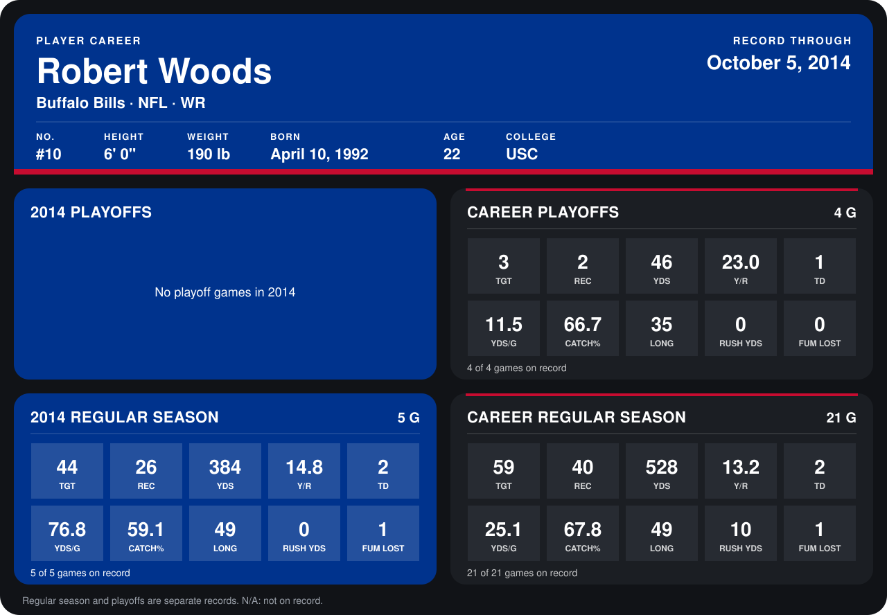

# Robert Woods

## Career stats

### Regular season

| Season | Club | G | TGT | REC | YDS | Y/R | TD | YDS/G | CATCH% | LONG | RUSH YDS | FUM LOST |
|---|---|---:|---:|---:|---:|---:|---:|---:|---:|---:|---:|---:|
| 2013 | Buffalo Bills | 16 | 15 | 14 | 144 | 10.3 | 0 | 9.0 | 93.3 | 24 | 10 | 0 |
| 2014 | Buffalo Bills | 5 | 44 | 26 | 384 | 14.8 | 2 | 76.8 | 59.1 | 49 | 0 | 1 |
| **Career** |  | 21 | 59 | 40 | 528 | 13.2 | 2 | 25.1 | 67.8 | 49 | 10 | 1 |

### Playoffs

| Season | Club | G | TGT | REC | YDS | Y/R | TD | YDS/G | CATCH% | LONG | RUSH YDS | FUM LOST |
|---|---|---:|---:|---:|---:|---:|---:|---:|---:|---:|---:|---:|
| 2013 | Buffalo Bills | 4 | 3 | 2 | 46 | 23.0 | 1 | 11.5 | 66.7 | 35 | 0 | 0 |
| **Career** |  | 4 | 3 | 2 | 46 | 23.0 | 1 | 11.5 | 66.7 | 35 | 0 | 0 |

## Awards

None on record.

Records through October 5, 2014. Identity: listed 2014 roster data, Weeks 1-4; number: 2014 Week 1 roster. [All Buffalo Bills players](README.md).
