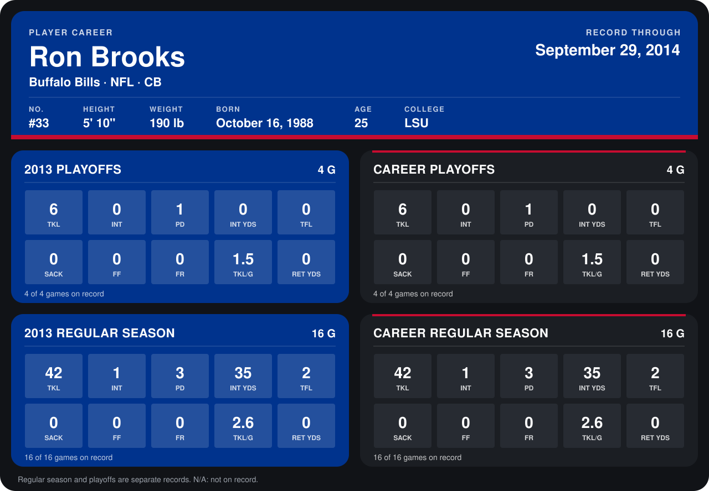

# Ron Brooks

## Career stats

### Regular season

| Season | Club | G | TKL | INT | PD | INT YDS | TFL | SACK | FF | FR | TKL/G | RET YDS |
|---|---|---:|---:|---:|---:|---:|---:|---:|---:|---:|---:|---:|
| 2013 | Buffalo Bills | 16 | 42 | 1 | 3 | 35 | 2 | 0 | 0 | 0 | 2.6 | 0 |
| **Career** |  | 16 | 42 | 1 | 3 | 35 | 2 | 0 | 0 | 0 | 2.6 | 0 |

### Playoffs

| Season | Club | G | TKL | INT | PD | INT YDS | TFL | SACK | FF | FR | TKL/G | RET YDS |
|---|---|---:|---:|---:|---:|---:|---:|---:|---:|---:|---:|---:|
| 2013 | Buffalo Bills | 4 | 6 | 0 | 1 | 0 | 0 | 0 | 0 | 0 | 1.5 | 0 |
| **Career** |  | 4 | 6 | 0 | 1 | 0 | 0 | 0 | 0 | 0 | 1.5 | 0 |

## Awards

None on record.

Records through February 2, 2014. Identity: listed 2014 roster data, Weeks 1-4; number: 2014 Week 1 roster. [All Buffalo Bills players](README.md).
