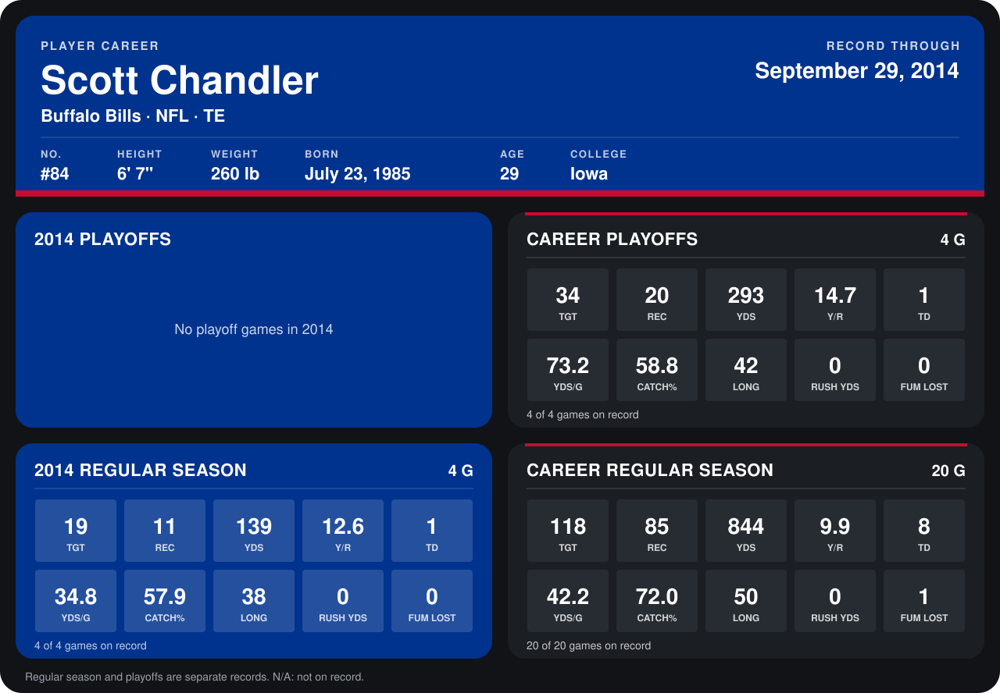

# Scott Chandler

## Career stats

### Regular season

| Season | Club | G | TGT | REC | YDS | Y/R | TD | YDS/G | CATCH% | LONG | RUSH YDS | FUM LOST |
|---|---|---:|---:|---:|---:|---:|---:|---:|---:|---:|---:|---:|
| 2013 | Buffalo Bills | 16 | 99 | 74 | 705 | 9.5 | 7 | 44.1 | 74.7 | 50 | 0 | 1 |
| 2014 | Buffalo Bills | 4 | 19 | 11 | 139 | 12.6 | 1 | 34.8 | 57.9 | 38 | 0 | 0 |
| **Career** |  | 20 | 118 | 85 | 844 | 9.9 | 8 | 42.2 | 72.0 | 50 | 0 | 1 |

### Playoffs

| Season | Club | G | TGT | REC | YDS | Y/R | TD | YDS/G | CATCH% | LONG | RUSH YDS | FUM LOST |
|---|---|---:|---:|---:|---:|---:|---:|---:|---:|---:|---:|---:|
| 2013 | Buffalo Bills | 4 | 34 | 20 | 293 | 14.7 | 1 | 73.2 | 58.8 | 42 | 0 | 0 |
| **Career** |  | 4 | 34 | 20 | 293 | 14.7 | 1 | 73.2 | 58.8 | 42 | 0 | 0 |

## Awards

- AP First-Team All-Pro (2013, TE)
- Pro Bowl selection (2013, TE)

Records through September 29, 2014. Identity: listed 2014 roster data, Weeks 1-4; number: 2014 Week 1 roster. [All Buffalo Bills players](README.md).
