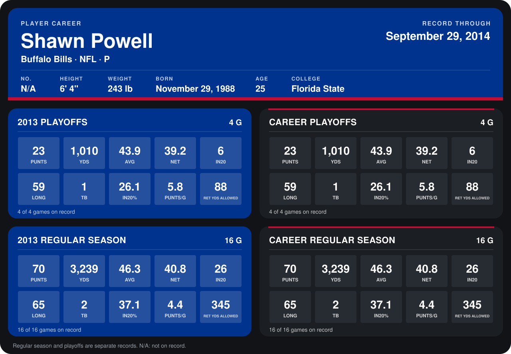

# Shawn Powell

## Career stats

### Regular season

| Season | Club | G | PUNTS | YDS | AVG | NET | IN20 | LONG | TB | IN20% | PUNTS/G | RET YDS ALLOWED |
|---|---|---:|---:|---:|---:|---:|---:|---:|---:|---:|---:|---:|
| 2013 | Buffalo Bills | 16 | 70 | 3,239 | 46.3 | 40.8 | 26 | 65 | 2 | 37.1 | 4.4 | 345 |
| **Career** |  | 16 | 70 | 3,239 | 46.3 | 40.8 | 26 | 65 | 2 | 37.1 | 4.4 | 345 |

### Playoffs

| Season | Club | G | PUNTS | YDS | AVG | NET | IN20 | LONG | TB | IN20% | PUNTS/G | RET YDS ALLOWED |
|---|---|---:|---:|---:|---:|---:|---:|---:|---:|---:|---:|---:|
| 2013 | Buffalo Bills | 4 | 23 | 1,010 | 43.9 | 39.2 | 6 | 59 | 1 | 26.1 | 5.8 | 88 |
| **Career** |  | 4 | 23 | 1,010 | 43.9 | 39.2 | 6 | 59 | 1 | 26.1 | 5.8 | 88 |

## Awards

None on record.

Records through September 29, 2014. Identity: the public player file's latest listing (no 2014 Weeks 1-4 roster row). [All Buffalo Bills players](README.md).
