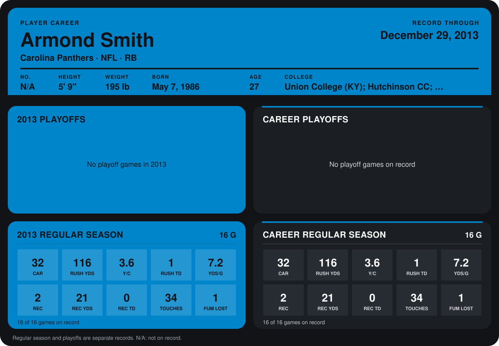

# Armond Smith

## Career stats

### Regular season

| Season | Club | G | CAR | RUSH YDS | Y/C | RUSH TD | YDS/G | REC | REC YDS | REC TD | TOUCHES | FUM LOST |
|---|---|---:|---:|---:|---:|---:|---:|---:|---:|---:|---:|---:|
| 2013 | Carolina Panthers | 16 | 32 | 116 | 3.6 | 1 | 7.2 | 2 | 21 | 0 | 34 | 1 |
| **Career** |  | 16 | 32 | 116 | 3.6 | 1 | 7.2 | 2 | 21 | 0 | 34 | 1 |

### Playoffs

No playoff games on record.

## Awards

None on record.

Schools listed: Union College (KY); Hutchinson CC; Shorter College.

Records through December 29, 2013. Identity: his listed 2013 season roster data (no 2014 Weeks 1-4 roster row). [All Carolina Panthers players](README.md).
